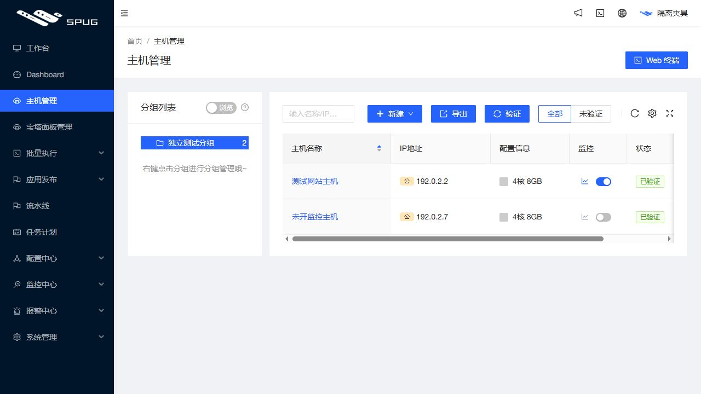
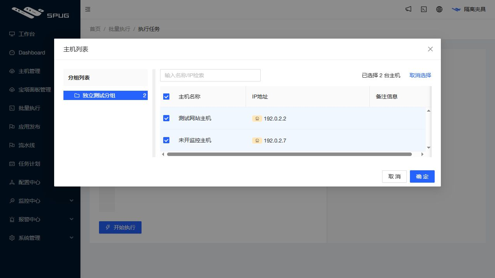
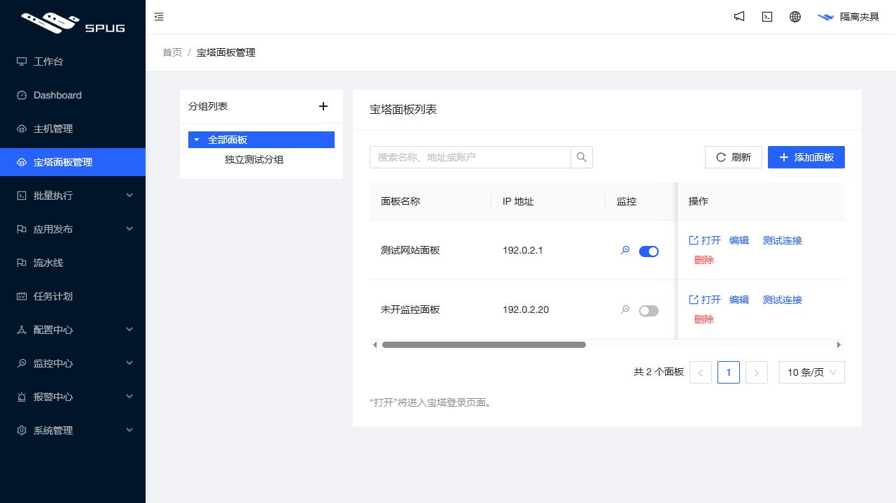
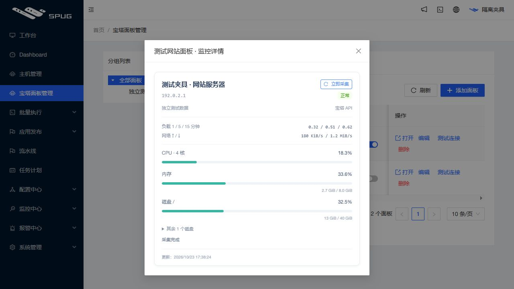
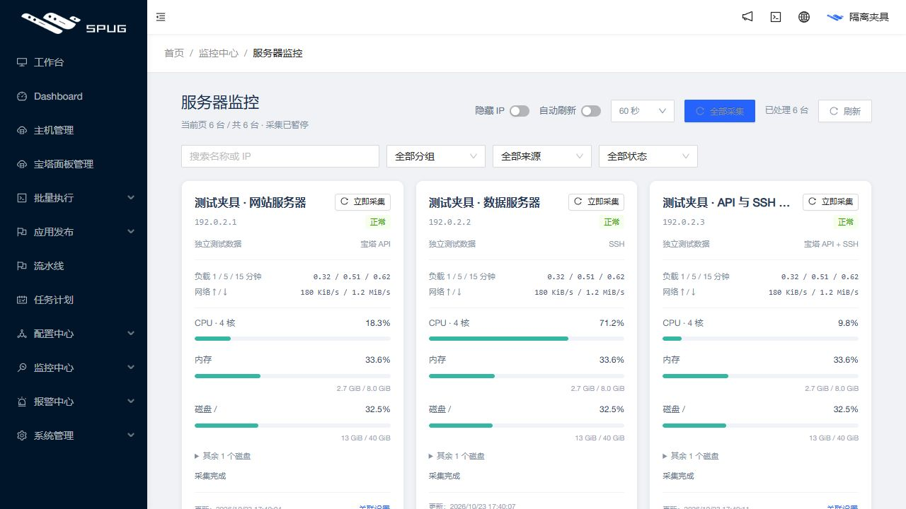
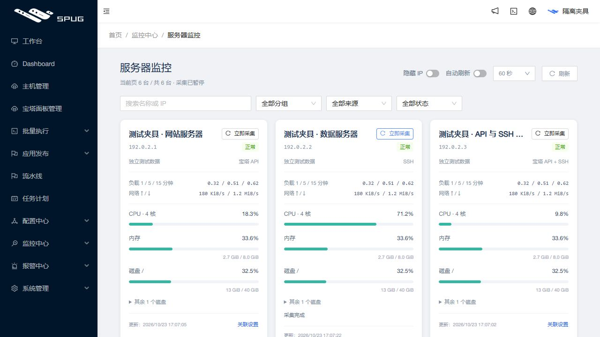
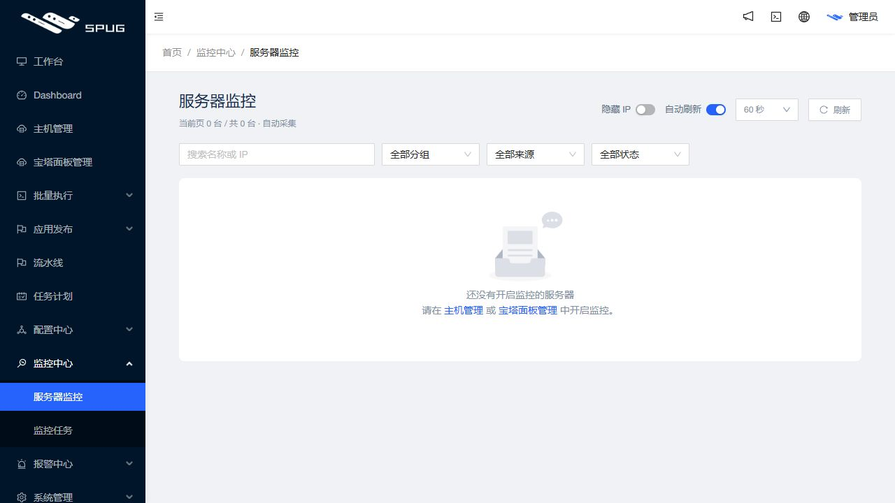
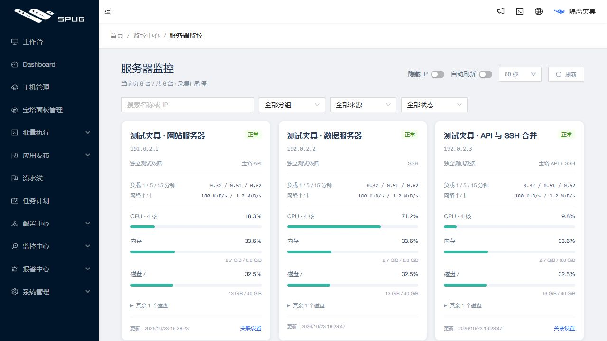

# 2026-10-23 服务器监控发布记录

## 宝塔版本同步与 SSL 网站到期信息

已发布源码 `6b5b3c8cb1004d2222069770cbdc4a729182046d`。客户面板在外部升级后，原列表仍保留上次测试连接时的版本；本次排查确认该客户实时 API 为 13.1.0、保存记录为 9.2.0。已通过已有测试连接同步。后续任务资源读取复用已经取得的实时版本，以 API 配置修订号作条件写回版本及检测时间；任务标题优先显示本次版本，列表明确标示“上次检测”。不增加后台全量轮询。

SSL 申请和续签的网站选项显示到期日期、已过期或未配置。复用官方 getData 的 ssl.notAfter，严格校验日期并只返回公开摘要；缺失或异常显示状态未知，官方 -1 显示未配置。选中详情使用已有 GetSSL 的证书到期时间，按北京时间显示。此展示不额外逐网站请求 API，不改变证书任务的预检和确认流程。

- 本机后端 349 项通过（4 项环境相关跳过）；前端 19 套件、168 项通过，修改模块 ESLint 和本机生产构建通过。保留上游 AutoDeploy.js 既有 Hook 告警。回归覆盖三种已适配宝塔版本的公开摘要、无额外请求、私有字段过滤、异常日期、配置并发变更、版本标题和北京时间跨日。独立代码复核无 Critical / Important。[源码提交 CI](https://github.com/851855817/spug/actions/runs/39949602127) 和 [PR CI](https://github.com/851855817/spug/actions/runs/39949606543) 的三个 job 均成功。
- 归档 `panel-metadata-6b5b3c8.tar.gz`，SHA-256 `5dfc8e02cea2acb9766025ce663566e37dacb98c156a75c3fa8bf9f15dd0d918`；25 个静态资源摘要通过，主资源 `main.3d81ee72.chunk.js`、`main.3c0fda0b.chunk.css`。
- 持久镜像 `spug-baota:6b5b3c8`，ID `d71607294969145ce9a6a9dadf653f6d9cf11856cec817ebdf7eedd9553cadcb`，基于 f8a3c66，仅复制模块与本机构建的静态资源。镜像三项接线检查、两项公开摘要测试通过。Compose 已指向此镜像；原运行容器基础仍 d48d73b，在线及启动目录均已更新 resources.py、task_views.py 和静态入口，仅重启 spug-api。原任务进程保持，八服务 RUNNING、容器 healthy、HTTP 200、无迁移；发布前后业务数据、监控偏好和密钥摘要一致。
- 私有 Compose、前后摘要、发布报告位于 `/opt/spug/backups/panel-metadata-6b5b3c8`；两处 API 模块备份 `/data/spug-api-backups/6b5b3c8cb1004d2222069770cbdc4a729182046d`，静态入口备份 `/data/spug-ui-backups/6b5b3c8cb1004d2222069770cbdc4a729182046d`。回退恢复两处 API 模块和静态入口、原 Compose，再重启 API；保留业务数据和用户配置。
- 正式浏览器已确认两台列表版本为 13.1.0，并在 SSL 下拉看到实际到期日、过期日及未配置；截图保存在工作区，未将客户域名截图提交公共仓库。验收仅读取资源，没有生成或执行证书、升级任务。

## 表格列宽拖动与监控图标

已热发布 `f8a3c661322cab3b364476421841bbe04b6e9889`。公共 TableCard 及 20 处直接业务表格接入同一个 ResizableTable：拖动表头右侧分隔线调宽、浏览器按页面与表格记忆、双击恢复该表默认列宽，方向键也可调整。列宽限制 64–1600 px，容器不足时横向滚动；保留排序、隐藏列、固定列、勾选、分页和弹窗行为。无表头文件队列保持原样；权限矩阵为合并单元格的原生表格，不纳入普通列表调宽。两张列表的监控图标按用户参考换成折线图。

- 前端 18 套件、163 项通过；新增八项回归含独立表格存储、首次拖动跨表头重挂载、卸载清理、固定定位、存储异常与重置。修改模块 ESLint、生产构建和独立审查通过，无 Critical / Important。构建仅在本机，限制单个压缩进程；保留上游 AutoDeploy.js 既有告警。[源码提交 CI](https://github.com/851855817/spug/actions/runs/39936942189) 和 [PR CI](https://github.com/851855817/spug/actions/runs/39936946160) 均成功。
- UI 夹具实测主机首列由 118 px 拖至 198 px，刷新保持；键盘调宽、双击重置及表头排序正常。宝塔列从约 174 px 缩至 114 px，操作栏保持 sticky；选择弹窗表头/内容/勾选列对齐并可全选。正式主机列表从约 81 px 拖至 141 px，刷新后保持，折线图图标已显示。验证仅改变浏览器列宽偏好。
- 归档 `table-resize-f8a3c66.tar.gz`，SHA-256 `48c0e5018989dd54f4481683aa3af42f74dc90961bd9e065d04028657c6a6e86`；25 个资源摘要校验通过。主资源 `main.23a67b80.chunk.js`、`main.3c0fda0b.chunk.css`。
- 持久镜像 `spug-baota:f8a3c66`，ID `771a09ed28a391e1bad33e806f0076816209660b92640e3db5111048333c8182`，三项离线检查通过，Compose 已指向该镜像。原运行容器仍为 `d48d73b`，八服务持续 RUNNING、容器 healthy、HTTP 200；未重启服务、无数据库迁移。业务数据、监控启用/关联偏好及密钥摘要和解密结果前后一致。
- 入口备份 `/data/spug-ui-backups/f8a3c661322cab3b364476421841bbe04b6e9889`；Compose、私有摘要及发布结果 `/opt/spug/backups/table-resize-f8a3c66`。回退可恢复两处入口和该备份的原 Compose，保留数据库及用户监控设置。

以下为独立夹具，非客户数据：

## 列表监控详情与全局主动采集

已热发布 `08d9ae8f423dedeb3c7da03bbfdb7e02cf9e1a9b`。主机和宝塔列表的监控列新增图标，点击打开对应服务器的监控卡片；已确认关联的两种来源复用同一张卡片。未开启时提示“未开启监控”，不读取详情或发起采样。保留原监控开关。宝塔列表隐藏完整面板地址和账户，显示 IP；“打开”仍使用保存的完整地址。缩小固定操作栏并允许换行，避免在 1280 px 页面遮挡监控开关。

监控中心新增“全部采集”，重新读取全部已启用来源后串行处理，覆盖其他分页和筛选外服务器，显示进度及“已处理 N 台”。沿用缓存、繁忙与失败退避；执行期间禁止重复提交，隐藏、离开或改变筛选后取消剩余处理。结束后保留原自动刷新开关状态。详情弹窗复用同一采集器，只采当前服务器，关闭后停止后续采集。

- 本机前端 17 套件、155 项全部通过，修改模块 ESLint 和 diff 检查通过，生产构建成功；保留上游 `AutoDeploy.js` 既有 Hook 告警。独立代码复核无 Critical / Important。源码 [提交 CI](https://github.com/851855817/spug/actions/runs/39933460185) 和 [PR CI](https://github.com/851855817/spug/actions/runs/39933465598) 的三个 job 均成功。
- 独立 UI 夹具实测两张列表的未开启提示、对应详情、主动采集及全局完成提示；前端回归覆盖合并来源、权限、关闭丢弃旧结果、全量跨分页和筛选、取消、退避以及自动模式恢复。正式浏览器确认两张列表图标、宝塔 IP 显示、对应合并卡片详情和监控中心全局按钮。
- 归档 `monitor-list-08d9ae8.tar.gz`，SHA-256 `6646a751ef062811397d7c54765b494825d75071f1ac0d46cf63a72560900879`；25 个资源摘要校验通过，主资源 `main.f10888e9.chunk.js`、`main.0c4caa11.chunk.css`。
- Compose 已指向持久镜像 `spug-baota:08d9ae8`，镜像 ID `40892981fe7adab7828b92f62f9edd1e2079a6471abf9bcb7c5a104bffdbd965`；镜像三项离线检查通过。仅更新两处静态目录，保留旧哈希、原子替换入口，无后端或数据库变更。运行容器仍基于 `d48d73b`，原容器和任务进程未重启，八服务 RUNNING、容器 healthy、HTTP 200。
- 原业务数据、监控启用和关联偏好、密钥摘要及解密结果前后一致。入口备份 `/data/spug-ui-backups/08d9ae8f423dedeb3c7da03bbfdb7e02cf9e1a9b`；Compose、私有前后摘要和发布结果 `/opt/spug/backups/monitor-list-08d9ae8`。回退只需恢复两处入口及该目录原 Compose，不覆盖数据库和监控设置。

以下为独立夹具，非客户数据：

## 单台主动采集更新

已热发布 `f21255f0867a9e6d04357f73ce0343d7fda053aa`：每张卡片右上角新增“立即采集”，只针对选中服务器，自动刷新暂停时仍可使用。采集中显示加载状态并防止重复提交；缓存、繁忙、失败退避均有简短结果提示。手动请求采用 30 秒最小采样间隔，复用全局串行队列和服务端限流；隐藏、离开、筛选后丢弃过时结果。补齐列表读取与手动采样交错、手动后自动周期计算的回归。

- 本机前端 16 套件、141 项通过，监控模块 ESLint 和 diff 检查通过；生产构建成功，保留既有 `AutoDeploy.js` Hook 告警。构建仅在本机进行，压缩工作进程限制为 1，避免本机并行压缩内存不足。
- 独立代码复核无剩余 Critical / Important。[提交 CI](https://github.com/851855817/spug/actions/runs/39929136559) 和 [PR CI](https://github.com/851855817/spug/actions/runs/39929141653) 全部成功。
- 归档 `monitor-manual-f21255f.tar.gz`，SHA-256 `cd6fe718407cf895e8249e0b50da43fd388ac3a3ad486f2887ac03a770a28db2`；25 个资源摘要校验通过。主资源 `main.bba50785.chunk.js`、`main.cfd817f4.chunk.css`。
- 在线及启动静态目录先复制资源、最后原子替换入口，保留旧哈希。Compose 已指向仅 COPY 静态文件的持久镜像 `spug-baota:f21255f`，ID `c95e706076786274db9c8b0abc26a0214a788b91a6f3d1eb548ff55b038b68be`。镜像 3 项离线检查通过。运行容器仍基于 `d48d73b`，未重启容器或任务进程，无数据库迁移。
- 原业务数据、监控偏好（含启用状态和关联）、密钥摘要及解密结果前后一致。监控快照和租约由正常采集更新，不纳入静态发布一致性摘要。八服务 RUNNING、容器 healthy、HTTP 200。
- 入口备份 `/data/spug-ui-backups/f21255f0867a9e6d04357f73ce0343d7fda053aa`；Compose、前后私有摘要和发布结果 `/opt/spug/backups/monitor-manual-f21255f`。回退本次 UI 可恢复两处入口与原 Compose，保留数据库和监控设置。
- 浏览器验证正式三张已启用卡片均显示按钮，未改客户开关或关联；独立夹具实际验证选中卡片加载、更新与完成提示，900 px 窄屏按钮未溢出。正式页面按用户已有启用设置继续正常自动采集。

以下截图为独立夹具，非客户数据：

## 首次监控功能发布

已部署源码 `d48d73b4dcbd2634e01b2d94423d4c0d36c358e5`，分支 `feature/server-resource-monitor`，基础分支 `feature/baota-panel-tasks`。开发记录保留于[草稿 PR #3](https://github.com/851855817/spug/pull/3)，未合并。

## 验证结果

- 本机后端 345 项：341 通过，4 项因 MariaDB／Linux／运行时条件跳过；前端 16 套件、130 项全部通过。修改模块 ESLint 无错误和告警，`git diff --check` 通过。
- [GitHub Actions](https://github.com/851855817/spug/actions/runs/39924296340) 三项 job 全部通过。固定 Linux 运行时后端 345 项，343 通过、2 项环境条件跳过；隔离 MariaDB 事务／并发 116 项全部通过，包括监控全局双槽和同目标互斥；前端 130 项及生产构建通过。
- 本机生产构建成功。保留原 `AutoDeploy.js` 的 `isAdmin` effect 依赖告警，未修改无关代码；Node／Paramiko 原有弃用提示不影响上述结果。
- 规格审查、代码质量审查通过。跨权限来源集合的失败计数、300→30 秒间隔切换、空列表自动发现均完成先失败后通过的回归。新增 HTTP 契约区分缓存采样年龄与失败／忙等待。
- 独立本机 HTTP／SSH 夹具验证实际子进程、认证、截止与回收；WSL BusyBox 实跑固定 Linux 探针。UI 夹具验证正常／失败／过期／待采集、双来源合并、磁盘展开、隐藏地址及桌面／窄屏，无客户连接。

## 发布产物

- 归档：`spug-monitor-d48d73b.tar.gz`，1,577,814 字节。
- SHA-256：`6c1be42726333dafd3324950ecf907fec3a537d2870c29c3e1b3691b02ea762e`。
- 正式镜像：`spug-baota:d48d73b`，镜像 ID `752af29ea640270dc857178beebdde7a2ff8ac25ad1016b139f49e4e79388ce6`。
- 兼容回退镜像：`spug-baota:monitor-rollback-d48d73b`，镜像 ID `2ba90b74ed94ba4d7c5debf3942a04e06bbcb4f5833a830b9d0af5d3285677f8`。
- 正式主资源：`main.27959b10.chunk.js`、`main.3e833d1b.chunk.css`。
- 服务器发布目录：`/opt/spug/releases/monitor-d48d73b`；执行日志为其中的 `release.log`。

前端仅在本机构建。服务器基于 `spug-baota:5437d77` 派生并复制源文件、静态文件，没有编译前端或安装依赖。该基线与旧运行容器 `2350559` 的 baota 后端 Python 文件总指纹一致，只有固化已热发布界面的镜像层不同。

## 迁移与上线验收

服务器先通过只读空闲预检，冻结入口后再次确认无用户任务、队列、PID、传输或客户外联。配套数据库、完整数据卷／密钥及 Compose／环境备份保留于权限受限的 `/opt/spug/backups/20261023-162729-before-resource-monitor`，校验和通过；不将备份内容或凭据提交 Git。

在禁止外联的临时 Docker 网络与克隆数据上，完成“新版 → 兼容回退版 → 新版”：三张表均存在、默认关闭；仅在克隆建立的禁用偏好标记经过两次切换保持，清理后恢复空表。每步原有记录和密钥指纹一致。演练使用受限临时资源，正式应用暂停期间执行，结束后清理克隆容器／卷／网络。

正式切换后，八个既有服务运行，容器 healthy、重启计数 0，HTTP 页面与主 JS 资源可访问；原宝塔、主机、模板、任务、设置及密钥指纹一致，原密码／API 密钥可解密。再次运行 `check.py empty` 确认无监控偏好、快照或租约；没有擅自开启客户监控或采样。

浏览器已确认 `/monitor/servers` 的空态与两处开启入口、两张列表的关闭开关以及原 `/monitor` 任务页。发布后资源快照：约 517 MiB 可用内存，2 GiB swap 未使用；此值仅代表当时的空闲状态，不构成开启监控后的负载保证。

## 界面证据

正式页面保持默认关闭：

以下为独立测试夹具，地址为文档保留网段，非客户监控数据：

## 回退

本次配套兼容回退镜像已实测。需要回退时先按空闲检查流程等待运行任务结束，将 `/opt/spug/docker-compose.yml` 的应用镜像切为 `spug-baota:monitor-rollback-d48d73b`，再以原卷、原环境运行 `docker compose up -d --pull never --no-deps spug`。八服务、HTTP、原数据指纹均需再次验收。保留新表和配置，不以旧镜像自动生成删表迁移，不自动覆盖数据库。重新启用新版使用正式镜像恢复。
