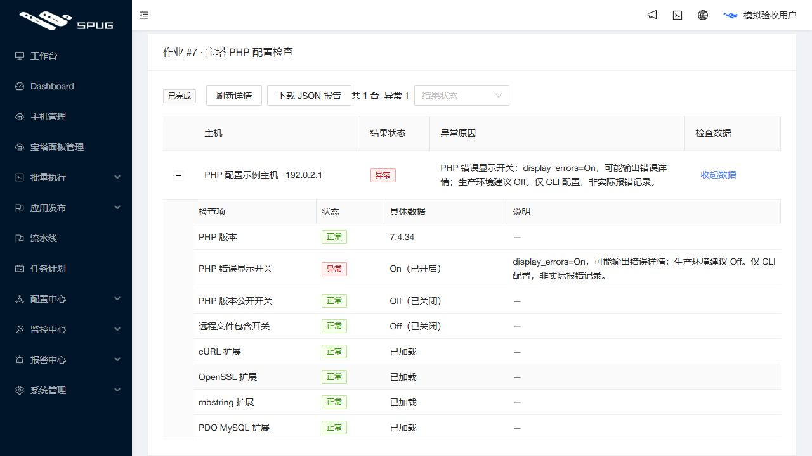

# 巡检具体异常原因发布记录

2026 年 10 月 26 日 16:15（Asia/Shanghai），应用由 `470eec9b8e76825b58879bc0a7bf3c6bdf69fe10` 更新为 `73e54ccf9ede7c6b197fd314f5a145c67ae394b4`。公网与本机演示入口均返回新版本；PR #4 保持草稿，未合并主分支。

## 用户可见变化

运维作业的历史告警不再只显示“需要关注”。固定 v1 检查按已保存值显示原因、告警线及简短建议：PHP 三个开关、三个必查扩展、内存、根分区和 TCP 80／443。具体数据使用 On／Off、加载／监听状态和百分比单位；正常项不再重复“已采集”。

截图中“显示错误”是 PHP CLI 的 `display_errors` 开关，并非已采集的 PHP 报错。现在显示“PHP 错误显示开关：display_errors=On”，解释风险与生产环境建议，并注明仅代表 CLI 配置、非实际报错记录。网站 PHP-FPM 与错误日志未核验，不改变客户配置。

未知版本、作业、字段或不符合规则的值不套用具体诊断；保留已有具体说明。没有修改采集、任务状态、权限、API、数据模型或迁移。历史结果直接生效，无需重新巡检。

## 验证

- 13 条新增真实字段回归先失败后通过；另补 7 条错型、边界及说明保留回归。最终前端全量 25 套／311 项通过，发布保护 96 项通过（Windows 条件跳过 Linux 文件锁一项）。独立只读审查无阻塞。
- 应用提交两次完整 GitHub CI 成功：[push](https://github.com/851855817/spug/actions/runs/40290498042)、[PR](https://github.com/851855817/spug/actions/runs/40290504554)。包括后端 524 项（9 条条件跳过）、MariaDB 240、前端 311、发布保护 96 和生产构建。
- 正式构建以本机模拟 PHP 7.4.34 历史告警验收：主行具体原因、展开 8 项数据、明确开关名称和值均正确。12 次请求全部只读，无基线／比较或写入请求。下图只含模拟数据和文档保留 IP。

- 服务器以只读、无网络、不挂载生产数据、256 MB／1 CPU 环境完成 524 后端、96 发布保护、10 旧保护及 6 镜像接线测试；实际镜像内容核对通过。
- 发布后只读打开真实历史作业 #7，确认两台主机显示具体 `display_errors=On` 原因，展开后显示 PHP 7.4.34、On／Off 及扩展加载状态。没有执行重新采集。

## 发布保全

本轮使用已有 `operations-ui` 固定配置，运行差异仅 `RunDetail.js`，两份 API 覆盖清单为空。归档 SHA-256：`1f6adec85be16ecfc3f3bd9db249be9ecf66bfb253d4c801bbb94fa5e3b0d0da`；镜像 `spug-baota:73e54cc`。

发布器重新核对实际版本、业务空闲及保全摘要，完成本轮新配对备份后才更新 UI：

`/opt/spug/backups/20261026-161508-before-upgrade-73e54cc-021d0dd2`

发布返回 `published=true`、`errors=[]`、HTTP 200。独立加载本轮产物、准备回执与备份后核验：63 项业务／模式／密钥保全对象不变；两份完整 API 各 233／273 文件不变；两份 UI 各从 87 变为 89 文件且符合清单，旧资源保留，UI 收据及配对备份有效。原容器和保留进程身份保持，9 项服务运行、15 项宿主机健康检查正常，健康 timer active；服务器、公网及本机演示入口版本一致。

未执行客户真实升级、安装、卸载、证书、远程命令、主动采集或宝塔登录；未开启客户监控或提醒。实际历史页验收只读取 Spug 已保存结果；真实客户截图仅保存在工作区外层，未提交公共仓库。
