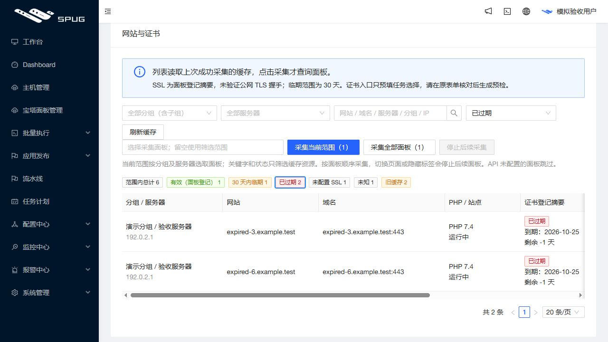

# 网站与证书统计快捷筛选发布记录

2026 年 10 月 26 日 17:06（Asia/Shanghai），应用由 `73e54ccf9ede7c6b197fd314f5a145c67ae394b4` 更新为 `597a36eeae7e3ae05c1106f68243ee0527e1a790`。公网与本机演示入口均核对为新版本；沿用 `feature/operations-reliability` 和草稿 PR #4，未合并主分支。

## 用户可见变化

网站与证书页面的范围内总计、有效、30 天内临期、已过期、未配置 SSL、未知和旧缓存统计均可点击，立即筛选对应记录。当前项蓝框高亮，与状态下拉框同步。点击总计仅清除状态，保留分组、服务器、关键词和每页条数，返回第一页；计数为零也能点击。

旧缓存按已有快照的有效性筛选，不等于证书已过期，在后端分页前完成。统计数字仍反映状态筛选前的查询范围。同一库存组件中的备份检查台同步支持快捷筛选，保留其既有逾期阈值。全部筛选读取 Spug 已保存缓存，不主动连接客户。

## 验证

- 新增 9 条真实前端交互回归及后端网站／备份旧缓存筛选回归先失败后通过；最终本地前端 25 套／320 项、后端 525 项、发布保护 100 项通过。Windows 分别跳过 11 条后端环境条件测试和一条 Linux 文件锁测试。独立只读审查无阻塞。
- 应用提交的完整 [push CI](https://github.com/851855817/spug/actions/runs/40296169719) 和 [PR CI](https://github.com/851855817/spug/actions/runs/40296178999) 均成功，包含后端 525 项（9 条条件跳过）、MariaDB 241、前端 320、发布保护 100 和生产构建。
- 正式构建以本机模拟数据验证各状态、旧缓存、总计恢复和键盘 Enter。27 次模拟接口请求均为 GET，无采集请求；下图仅包含模拟域名和文档保留 IP。

- 服务器以无网络、只读、不挂载生产数据、256 MB／1 CPU 的隔离环境完成 525 后端、100 发布保护、10 旧发布保护及 6 镜像检查，镜像内容核对通过。
- 发布后只读验收真实库存：已过期显示 4 条且每行均已过期，未配置 SSL 显示 2 条；旧缓存计数 0 仍可点击并显示空列表；点击总计恢复 11 条及全部状态。筛选后的摘要保持不变。真实客户截图只保存在仓库外层，未提交公共仓库。

## 发布保全

本轮新增固定发布配置 `inventory-filters`，运行差异严格限制为库存前端组件及 API listing 服务，保全既有 PHP 更新策略和平台健康模块；没有模型或迁移变化。归档 SHA-256：`abedfd1173d41f4d1e6ee707c3041f35a2efcb80fddd4c2c912f5e864b9f0543`；镜像 `spug-baota:597a36e`。

发布器重新核对实际版本、业务空闲与保全摘要，完成本轮新配对备份后才更新：

`/opt/spug/backups/20261026-170628-before-upgrade-597a36e-24b42aba`

发布返回 `published=true`、`errors=[]`、HTTP 200。独立重新加载本轮产物与备份核验：63 项业务／模式／密钥保全对象不变；两份完整 API 各 233／273 个文件仅 `apps/baota/inventory/service.py` 变化；两份 UI 各从 89 变为 91 个文件，符合清单并保留旧资源。API 与 UI 原始备份收据和配对备份有效，Compose 更新符合预期。原容器与保留进程身份保持，9 项服务运行、15 项宿主机健康检查正常，健康 timer active。服务器、公网及本机演示入口版本一致。

未执行客户真实升级、安装、卸载、证书、远程命令、主动采集或宝塔登录；未开启客户监控和提醒。发布保留兼容回退和正常服务。
