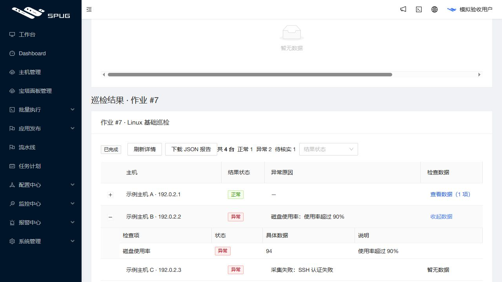

# 任务与作业结果精简发布记录

2026 年 10 月 26 日 15:54（Asia/Shanghai），应用从 `f352e947f2f82fcc1f60ee74592d8cb27074e00c` 更新为 `470eec9b8e76825b58879bc0a7bf3c6bdf69fe10`。发布后公网 `https://47.104.88.147/` 和本机演示入口返回相同新版本；说明提交晚于应用提交。PR #4 保持草稿，未合并主分支。

## 可查看的结果

- 运维作业：Linux／PHP／Web 共用四列结果：主机、正常／异常／待核实、异常原因、检查数据。具体指标按需展开，保留状态筛选；移除基线比较与审计流水。
- 面板任务：保留目标、状态、异常原因、版本／域名／目录等业务数据；核验结果和必要预检证据按需查看。软件阻挡条件、跳过原因和 SSL 的实际证据、影响范围与核验限制仍可见。结束的批次说明与审计流水不再堆叠展示。
- 文件上传：仅非零汇总，逐文件显示路径、大小、状态和异常原因。
- 原生命令／文件分发：显示当前主机状态并保留真实输出；断线哨兵 `-1` 显示“结果待核实”，不作为远端失败退出码。
- 任务计划：运行时间、汇总及逐台状态、退出码、耗时和实际输出；没有退出码显示待核实。流水线保留节点状态和输出，隐藏正常连接的技术提示。

执行确认、权限、分批暂停、取消、人工核实及结果轮询合同保持。已有后台历史保留；本轮不修改 API、数据模型或迁移。

## 验证

- 本地前端全量 25 套／291 测试通过。发布保护 96 项通过；Windows 仅跳过 Linux 文件锁测试。
- 应用提交的两次完整 GitHub CI 成功：[push](https://github.com/851855817/spug/actions/runs/40288233294)、[PR](https://github.com/851855817/spug/actions/runs/40288237773)。包括 Linux 后端 524 项（9 条条件跳过）、MariaDB 240、前端 291、发布保护 96 及生产构建。
- 正式构建在本机模拟 API 的真实浏览器中验证正常／异常／待核实、失败原因、展开具体数据与状态筛选；14 次请求均只读，无基线或比较请求。下图使用文档保留 IP 与模拟数据，并非客户实际巡检。

- 本机构建曾触发内存不足。查明 CRA 启动子进程，CLI 的串行预载未继承；改由 `NODE_OPTIONS` 传递后验证子进程只见 1 个 CPU，再按实际压缩需求使用 768 MiB 堆，正式构建成功。未停止用户应用或更改系统分页设置。既有 AutoDeploy Hook、Node 弃用、Paramiko 与 Docker legacy builder 提示保留。
- 服务器准备在只读、无网络、不挂载生产数据、限制 256 MB／1 CPU 的环境中完成实际镜像内容核对、524 后端、96 发布、10 旧保护与 6 镜像接线测试。

## 发布与保全

固定 `task-results-ui` 配置精确要求八个 UI 运行文件差异，两份 API 覆盖清单为空；准备阶段核对新旧不可变镜像的完整 API 文件集合和摘要，发布阶段禁止调用 API 覆盖／恢复助手。无迁移。

归档 SHA-256：`606600451d456bc63ae817fb6b0f8a5179932407cce8719a61a7a1dcd5d4e279`。实际镜像 `spug-baota:470eec9`。发布重新核对现网版本和空闲状态，完成新配对备份后才写入 UI：

`/opt/spug/backups/20261026-155433-before-upgrade-470eec9-2f38ce2f`

发布器返回 `published=true`、`errors=[]`、HTTP 200、9 服务运行。独立重新加载归档、准备回执和备份验证：

- 63 项业务／模式／迁移／密钥保全对象不变；两份完整 API 各 233／273 文件完全不变。
- 两份 UI 各从 83 变为 87 文件，符合新清单，保留旧资源供已打开页面使用；UI 原始备份收据与新配对备份有效。
- 原容器与 Redis／旧 worker／monitor 进程身份保持，Compose 仅替换后续重建镜像。9 服务正常，健康 timer active，独立宿主机诊断含最新备份验证，15 项全部 ok。

未执行客户真实任务、升级、安装、卸载、证书、远程命令、主动采集或面板登录；未开启客户监控和提醒。浏览器展示验收使用模拟数据，生产入口版本与实际部署文件另行独立核对。
