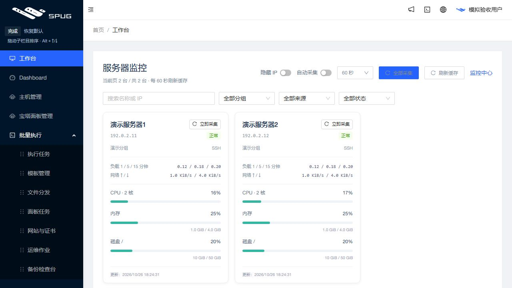
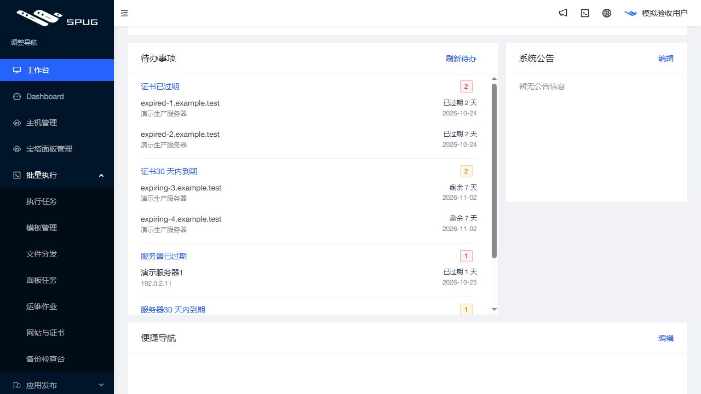

# 首页监控、到期待办与导航排序发布记录

2026 年 10 月 26 日 18:25（Asia/Shanghai）发起受控发布，应用从 `597a36eeae7e3ae05c1106f68243ee0527e1a790` 更新为 `b6ad1b185fb7016dcbb6d7b4677ee5153e555b66`。公网、本机及服务器入口均验证为新版本。沿用 `feature/operations-reliability` 和草稿 PR #4，未合并主分支。

## 用户可见变化

- 首页顶部复用服务器监控，保留筛选、分页、单台与全部采集。首页默认关闭自动采集，每 60 秒只刷新已保存缓存，隐藏页面停止刷新；原独立监控页面保持默认行为。
- 管理员首页显示证书已过期／30 天内到期、服务器已过期／30 天内到期四类待办，含完整数量、前三条、日期及剩余天数。类别与具体条目可跳转对应筛选页面，全部来自本地库存与日期登记。部分失败单独提示，未采集或过期证书数据提示不完整。
- 侧栏“调整导航”支持同组子栏目拖拽、Alt＋↑／↓、自动保存与恢复默认，按账户和浏览器保存。权限先过滤再排序，不能跨组或显示无权栏目。

使用方法见[首页与导航说明](../workbench-guide.md)和[完整手册](../spug-platform-user-manual.md)。

## 验证

新增行为与发布保护测试先红后绿。独立审查发现零面板误报不完整、超长名称跳转丢失关键词两处 P2，新增三条回归修复；最终审查无阻塞。本地前端 27 套／342 项、发布保护 104 项通过；Windows 一条 Linux 文件锁测试条件跳过。

应用提交的 [push CI](https://github.com/851855817/spug/actions/runs/40306324261) 与 [PR CI](https://github.com/851855817/spug/actions/runs/40306557675) 均成功，包含后端、MariaDB、前端、发布保护和生产构建。

正式构建使用回环地址模拟客户数据验收：原生同组拖动、刷新后保存、键盘排序、恢复默认均正常；证书链接同步面板／关键词／临期筛选并只显示对应网站，服务器链接同步地址与过期筛选。包括 60 秒刷新在内共 72 次模拟接口请求均为 GET。下图仅含模拟域名、用户与文档保留 IP。

服务器在无网络、只读、不挂载生产数据的环境通过 525 后端测试（9 条条件跳过）、104 发布保护、10 既有发布保护、6 镜像检查。新旧不可变镜像的完整 API 文件树一致。

上线后真实页面只读验收：显示两台已开启监控的服务器，自动采集开关关闭；证书已过期计数 4、30 天内到期计数 1，服务器两类计数均为 0。点击临期网站可见对应面板、关键词和临期状态，结果为一条。以上为本地缓存与登记数据，不代表已验证公网 TLS 或云厂商续费。真实截图只保存在仓库外，未提交公共仓库。

## 发布保全与回退

新增严格 `workbench-ui` 配置，仅允许九个已审查的 UI 运行文件；没有 API 覆盖、模型或迁移。归档 SHA-256 为 `4b8978b76f18b7e3e97c9b1c52cb0d233e02ae22c84f9c702b2f1ec345c81f09`，镜像为 `spug-baota:b6ad1b1`。

重新核对实际版本、业务空闲及保全数据后创建本次新配对备份：

`/opt/spug/backups/20261026-182545-before-upgrade-b6ad1b1-3ce7e0c8`

发布返回 `published=true`、`errors=[]`、HTTP 200。独立验证配对备份及 UI 原始收据有效，63 项业务／模式／密钥保全对象不变，两份完整 API 各 233／273 文件不变，UI 文件按清单由各 91 增至 96 并保留既有资源。Compose 与新版本一致，原容器和保留进程身份保持，9 项服务运行，15 项宿主机健康检查正常，健康 timer active。

失败回退沿用完整原始 UI 收据及业务空闲门，不执行 API 覆盖或恢复，不需要数据库迁移。个人排序保存在浏览器，旧版会忽略，新版也只应用真实获权路径。

本轮未执行客户真实升级、安装、卸载、证书任务、远程命令、主动采集或宝塔登录，未开启客户监控或提醒。
