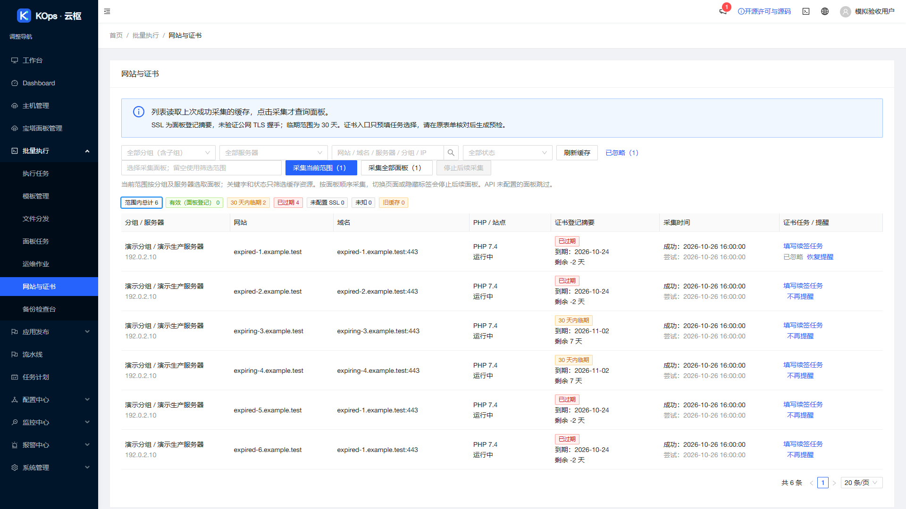
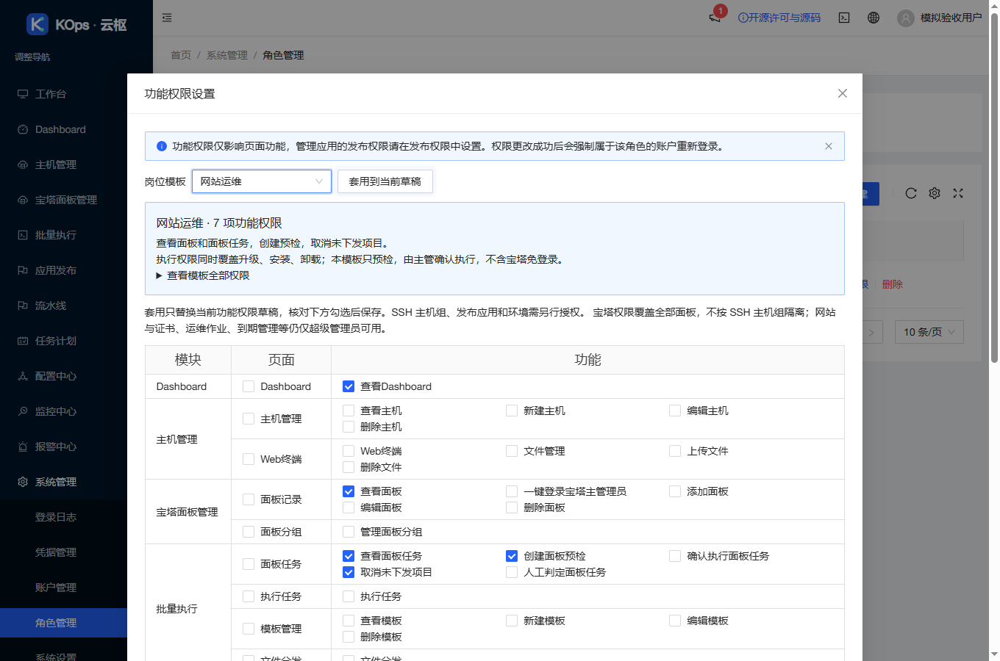
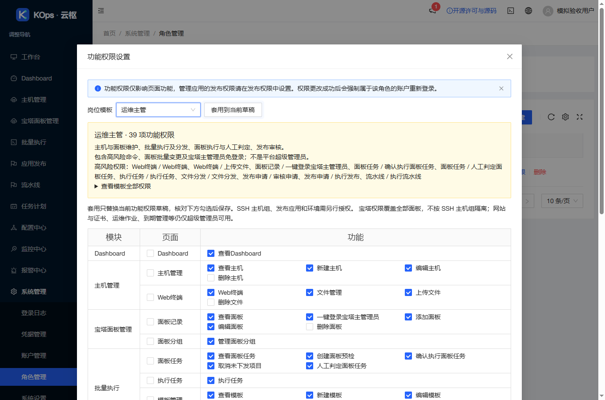

# 网站清单提醒与员工岗位模板发布

2026-10-27 18:04（Asia/Shanghai）受控发布应用 `9f749a877703aa593b9e95718f2520c775571057`，实际基准为 `46a5d9f28cfd2d967ad1fa34188f39ac58248c35`。沿用 `feature/operations-reliability` 和草稿 [PR #4](https://github.com/851855817/spug/pull/4)，未合并主分支。

## 功能与入口

**批量执行 → 网站与证书**：临期和已过期证书的“证书任务 / 提醒”列提供“不再提醒”；已忽略项保留网站行、续签入口及真实统计，并显示行内“恢复提醒”。顶部“已忽略”管理入口复用已有个人偏好，首页同证书同步，日期变化重新提醒，设置只影响当前账号。

**系统管理 → 角色管理 → 功能权限**：提供只读审计、值班运维、网站运维、发布工程师、运维主管五个岗位模板。选择可预览说明、完整权限和高风险项；“套用到当前草稿”替换勾选后仍可调整，管理员保存时沿用原角色 PATCH。取消不会写入角色，未自动新建线上角色或给员工授权。

岗位模板只包含实际可配置权限码，所有岗位都没有超级管理员授予。网站岗位只允许创建面板预检；现有执行权限包含升级、安装与卸载，由主管接手。主管含面板执行、人工判定及宝塔主管理员单次登录，页面明确风险。主机组、发布应用及环境单独分配；宝塔权限覆盖全部面板，不按 SSH 主机组隔离，现有超级管理员专用页面保持权限限制。

使用说明：[岗位模板](../role-presets-guide.md)、[个人提醒](../personal-reminders-guide.md)。以下为正式构建的隔离模拟验收截图，不含客户数据：

## 验证

- 前端 32 套／380 项全部通过。库存三项新回归先失败后修复；岗位数据和草稿／取消／保存回归先失败后实现。
- 正式生产构建通过，只有两处既有 Hook 依赖提示。独立审查另跑 35 项，使用真实 MobX 与实际组件验证草稿勾选更新、取消重开恢复已存权限、零接口写入，未发现必须修复项。
- 实际 headless Chrome 核对网站行与统计保留、提醒首页同步、行内恢复，以及模板风险说明、套用后真实勾选变化、取消零写入、保存指定角色 ID 的既有 API。浏览器无运行异常；接口全模拟，仅允许模拟个人设置 POST 与模拟角色 PATCH。
- 服务器无网络隔离准备：530 后端（9 项条件跳过）、120 发布保护、10 旧发布保护、6 镜像检查通过。完整 API 树及精确 UI 配置、配对备份和失败恢复回归保持；Linux 锁测试实际运行。
- [PR CI](https://github.com/851855817/spug/actions/runs/40485129661) 与 [push CI](https://github.com/851855817/spug/actions/runs/40485118715) 成功，含后端、MariaDB、前端与构建。
- 匿名验证精确公开应用提交和 4,471,416 字节源码归档，原 LICENSE、依赖、实际改动源码及发布工具相同。原版权、AGPL 和正式构建对应源码入口保持。

## 发布与独立保全

使用固定 `inventory-role-presets-ui`，恰好接受网站库存页面、角色功能权限页面和岗位模板数据三个 UI 运行文件；无 API 覆盖、模型、迁移或实际角色授权数据修改。发布前重新验证现网版本、业务空闲、完整保全与回退合同，新备份后受控发布。旧 UI 忽略额外提醒入口，四入口 UI 回退保持。

归档 SHA-256：`ddd154364709e1fa86636dac5f704bd57956595e2cfcc51d09098b8a44f75051`。

新配对备份：`/opt/spug/backups/20261027-180413-before-upgrade-9f749a8-eb79ee06`。

发布结果 `published=true`、`errors=[]`、HTTP 200。独立核对备份、63 项业务／模式／密钥对象和原保留进程身份不变；两份完整 API 树各 233／273 文件不变，UI 各 111 → 115，原始 UI 收据有效。9 服务和 15 健康检查正常，健康 timer active。本机隧道、公网及服务器入口均返回实际新版本，正式 JS 含个人提醒、五岗位模板和相同源码提交。

测试未执行客户真实任务、远程命令、主动采集或宝塔登录，未开启监控和提醒。线上仅执行平台发布与只读保全核验；脱敏机器摘要见 [验收摘要](2026-10-27-inventory-role-presets-verification.json)。
