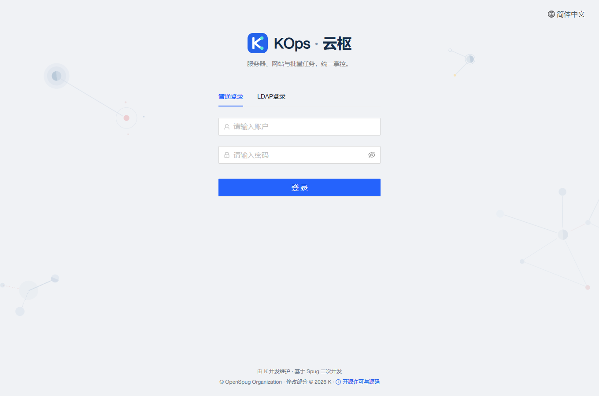
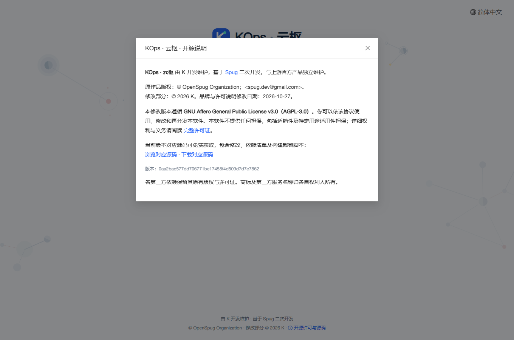
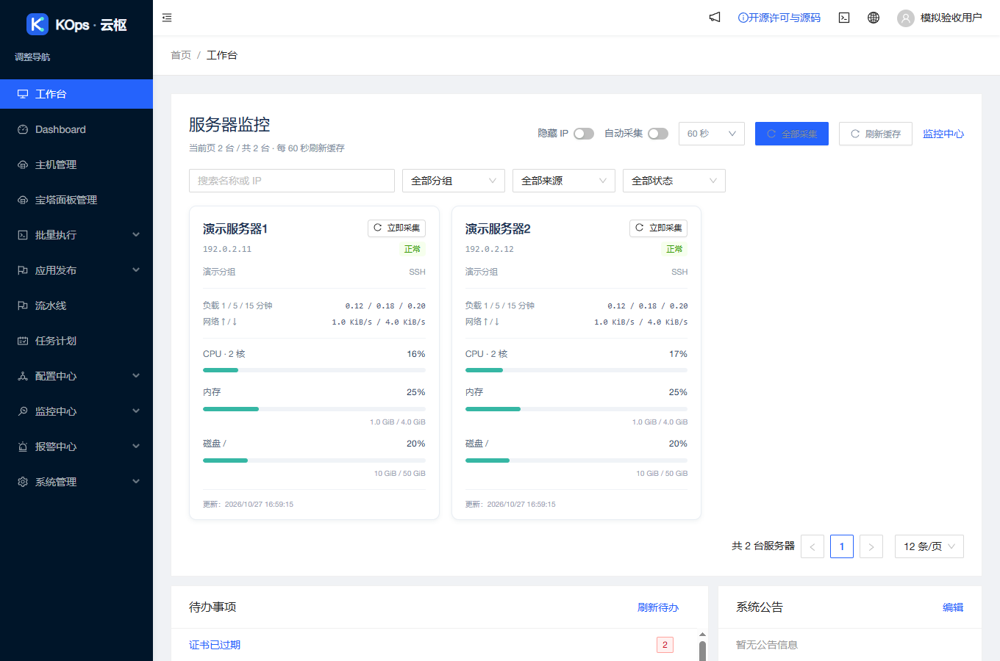

# KOps · 云枢品牌与开源说明发布

2026-10-27 17:01（Asia/Shanghai）受控发布应用 `0aa2bac577dd706771be17458f4d509d7d7e7862`，实际基准为 `03b9f44037d6c942ac42b8c4ca95830ef41cb1f7`。沿用 `feature/operations-reliability` 与草稿 [PR #4](https://github.com/851855817/spug/pull/4)，未合并主分支。

## 展示及许可

登录页、侧栏、浏览器标题、站点图标、关于页面及独立 Web 终端使用 **KOps · 云枢**。侧栏折叠只显示 K 标志，原默认头像换成通用用户图标。登录页简短标注 K 开发维护及基于 Spug 二开。

登录页、顶栏和独立 Web 终端均有“开源许可与源码”，无需管理员权限。弹窗保留 OpenSpug 原版权、二开日期、AGPL v3、无担保与再分发说明，提供原文 LICENSE、当前发布提交的源码浏览及下载链接。根许可证和源文件版权保留，真实第三方服务与内部标识不冒充自有服务。

公开源码仓库匿名可查，实际发布提交 [完整对应源码](https://github.com/851855817/spug/tree/0aa2bac577dd706771be17458f4d509d7d7e7862) 已提供。匿名 GitHub API 核对仓库 public 及精确提交；从 archive 跳转目标 codeload 匿名下载 3,866,961 字节，核实 LICENSE、修改说明、依赖锁文件和构建部署脚本。当前本机对 GitHub HTML 域名曾有连接超时，未将其表述为浏览器下载成功。

品牌截图为本次正式构建的本地隔离验收，所有主机、指标和用户均为模拟数据：

## 验证

前端 28 套／359 项、生产构建与独立只读审查通过。构建只有两处既有 Hook 依赖提示。新功能与中文路径打包回归均先失败后修复；打包改用 Git NUL 分隔枚举，保留既有中文模板文件原始路径与字节。

实际 headless Chrome 验证登录页、公共法律弹窗、发布提交固定源码链接、顶栏入口、折叠品牌及独立终端入口；375px 登录页面无横向溢出，没有运行异常。浏览器只访问回环模拟服务，所有非 GET 写请求拒绝，未连接客户主机。手机及终端截图也保存于 `docs/images/kops-branding-{mobile,terminal}.png`。

服务器隔离环境运行 529 后端测试（9 项条件跳过）、116 发布保护、10 旧发布保护、6 镜像检查通过。无网络测试容器使用隔离数据库，不挂载业务数据。应用提交的 [push CI](https://github.com/851855817/spug/actions/runs/40477003232) 与 [PR CI](https://github.com/851855817/spug/actions/runs/40477011754) 均成功，包括后端、MariaDB、前端及生产构建。

## 发布与保全

固定 `branding-ui` 配置恰好允许十六个品牌 UI 文件，API 覆盖清单为空，无模型、迁移或权限变化。新静态资源置于 `kops-20261027/`，保留旧文件和散列资源，兼容回退仍只恢复既有四个入口。正式构建注入完整提交，后续标准增量发布继续绑定各自对应源码。

本次新配对备份：`/opt/spug/backups/20261027-170112-before-upgrade-0aa2bac-7e4d5570`。

归档 SHA-256：`5f00d6a2d9e44bed9b3a39414b4174fb8661e2d5ce67d3920e21b178dabbadff`。

发布返回 `published=true`、`errors=[]`、HTTP 200。独立复核配对备份与 UI 原始回执有效，63 项业务／模式／密钥对象一致，原容器及保留进程身份不变；两份完整 API 文件树各 233／273 个文件全部不变，UI 各 98 → 106 个文件。9 项服务及 15 项健康检查正常，timer active。

服务器、本机 `http://127.0.0.1:18080/` 与公网 `https://47.104.88.147/` 均核对为实际发布版本、品牌标题和原文许可证；正式主 JS 含相同发布提交与对应源码仓库。线上只做 HTTP／文件／摘要验证，真实页面视觉验收使用完全相同构建的隔离浏览器。没有登录客户宝塔或执行客户任务、远程命令、主动采集，也没有启用监控或提醒。

相关说明：[修改范围及构建](../../MODIFICATIONS.md)、[受控发布](../../deploy/upgrade-review/README.md)。
