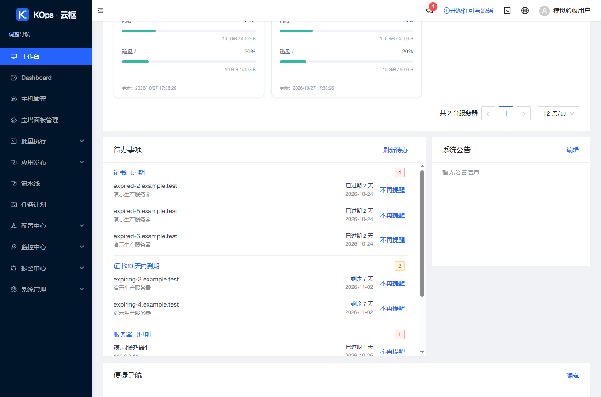
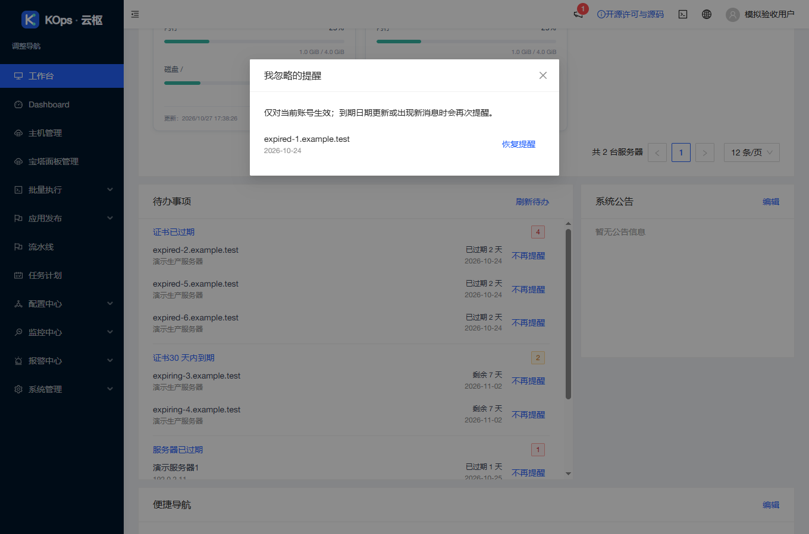
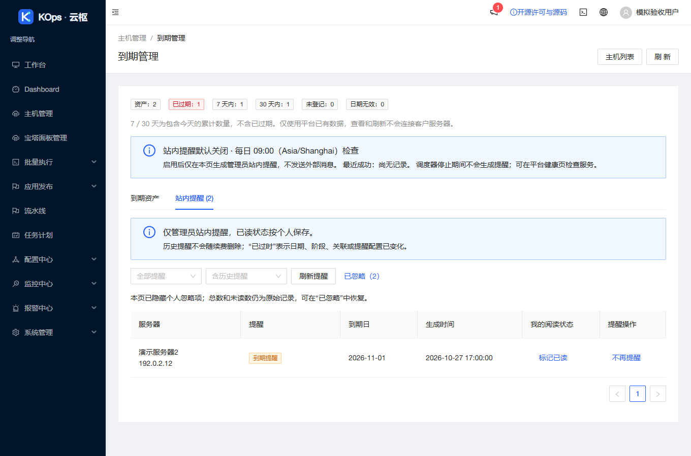
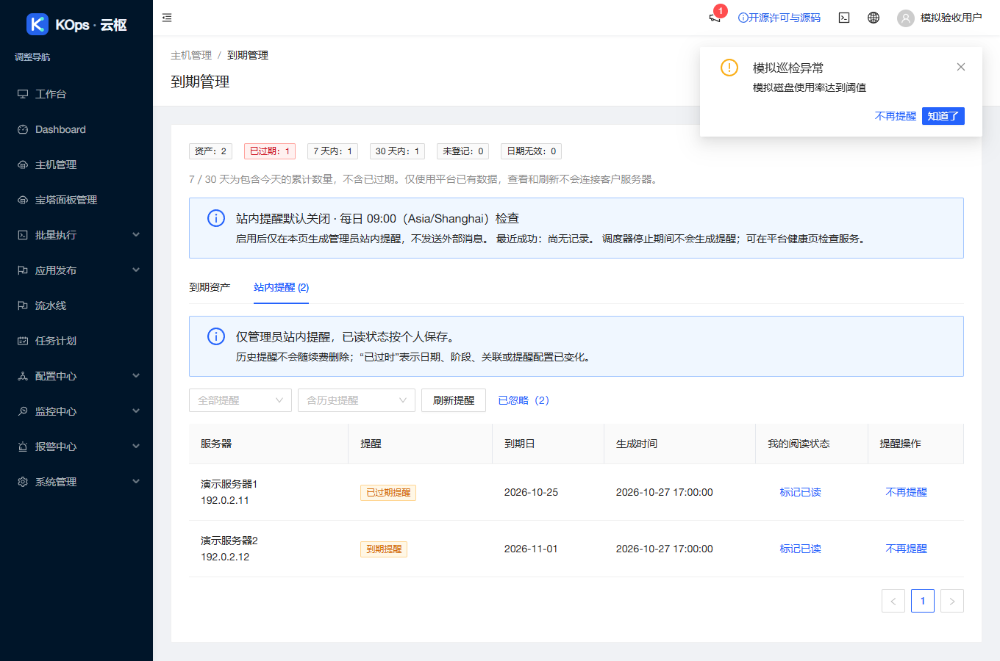

# 个人“不再提醒”发布与验收

2026-10-27 17:39（Asia/Shanghai）发布应用 `46a5d9f28cfd2d967ad1fa34188f39ac58248c35`，实际基准 `0aa2bac577dd706771be17458f4d509d7d7e7862`。沿用 `feature/operations-reliability` 和草稿 [PR #4](https://github.com/851855817/spug/pull/4)，未合并主分支。

## 使用方式

首页证书／服务器到期待办、顶栏通知列表及实时弹窗、主机管理 → 到期管理 → 站内提醒，逐条提供“不再提醒”。只影响当前账号，其他账号继续提醒；复用按用户隔离的设置 API，刷新和跨浏览器保留。到期日期变化或新通知 ID 会重新提醒。“已忽略（N）”可逐条恢复。

隐藏不删除资产和历史，不修改全局已读；首页最多展示当前页三条未忽略事项并补位，原始分类总数保留。保存失败保留原条目。具体说明见 [使用指南](../personal-reminders-guide.md)。

## 验证结果

- 前端 30 套／371 项及生产构建通过，仅有两处既有 Hook 依赖提示。
- 现有用户设置 API 的真实隔离数据库回归通过，核对两用户隔离、不覆盖其他设置、不改变全局已读。
- 独立只读审查发现并修复实时告警在列表读取失败时被吞掉、恢复隐藏通知后已读状态显示错误两项问题；新增回归先失败再修复通过，复审无必须修复项。
- 服务器无网络隔离准备：530 后端测试（9 项条件跳过）、118 发布保护、10 旧发布保护及 6 镜像检查通过。Linux 独占锁测试实际运行，本机该项条件跳过。
- [PR CI](https://github.com/851855817/spug/actions/runs/40481826223) 与 [push CI](https://github.com/851855817/spug/actions/runs/40481820149) 均成功，含后端、MariaDB、前端及构建。
- 实际 headless Chrome 验证首页隐藏／补位、刷新持久、恢复、日期变化、第二账号不受影响、首页与到期提醒共享身份、通知列表和实时弹窗、同内容新消息再次提醒；无运行异常。仅允许模拟用户设置 POST，所有客户接口模拟。
- 匿名核对公开仓库、精确应用提交和 4,120,766 字节源码归档，许可证、改动源码、依赖及发布脚本一致；继续保留 AGPL 和实际发布提交源码入口。

以下截图全部为相同正式构建的本地模拟数据，不含客户信息：

## 发布与保全

使用固定 `personal-reminders-ui`，恰好允许七个 UI 运行文件；无 API 覆盖、迁移和权限变更。个人设置沿用既有接口，旧版本会忽略这些设置；兼容回退只恢复四个 UI 入口，不删除偏好。

归档 SHA-256：`36df4f96c51e3c17359177ea66d8c3bb17a3f697a15270d73f21c91b53305f4d`。

本次新配对备份：`/opt/spug/backups/20261027-173902-before-upgrade-46a5d9f-f6d14ce8`。

发布前重新核对版本、业务空闲和资源，独占锁保护下新备份后发布，返回 `published=true`、`errors=[]`、HTTP 200。独立复核配对备份与 UI 原始收据有效，63 项业务／模式／密钥对象和原保留进程身份不变；两份完整 API 树各 233／273 文件全部不变，UI 各 106 → 111 文件。9 服务／15 健康检查正常，健康 timer active。

服务器、本机隧道及公网入口均核对新版本、品牌标题、许可全文和固定源码提交。线上验证仅为 HTTP／文件／摘要读取，未向客户执行任务、主动采集或登录宝塔，未开启监控或提醒。机器可读的脱敏摘要见 [验收摘要](2026-10-27-personal-reminders-verification.json)。
