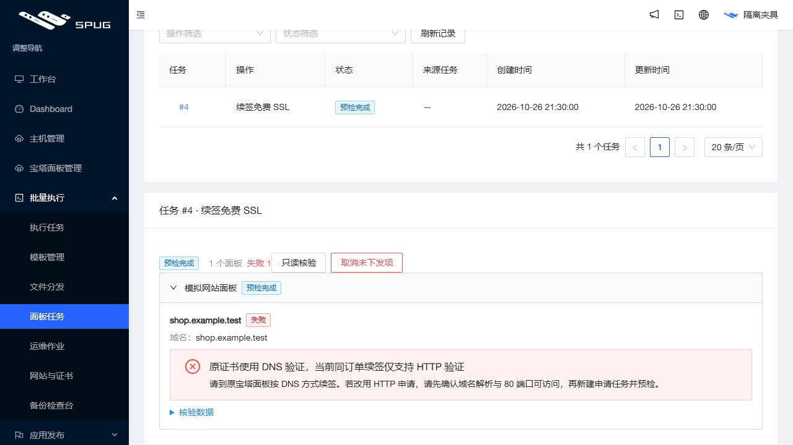

# SSL 续签预检诊断发布记录

2026 年 10 月 27 日 15:48（Asia/Shanghai）受控发布应用 `03b9f44037d6c942ac42b8c4ca95830ef41cb1f7`，原版本为 `b6ad1b185fb7016dcbb6d7b4677ee5153e555b66`。开发分支沿用 `feature/operations-reliability`，草稿 [PR #4](https://github.com/851855817/spug/pull/4) 未合并。

## 用户可见变化

入口：批量执行 → 面板任务 → 执行记录 → 打开任务。

原证书使用 DNS 验证时，预检准确显示“原证书使用 DNS 验证，当前同订单续签仅支持 HTTP 验证”，并建议到原宝塔面板按 DNS 方式续签。若改用 HTTP 申请，须确认域名解析和 80 端口可访问，再单独创建申请任务与预检。系统不会自动切换验证方式或创建替代订单。

HTTP 验证方式未核实、唯一匹配订单缺失也有固定原因和建议。未知第三方异常继续脱敏。既有失败任务只在冻结快照明确为 DNS、预检及结果均失败、无执行意图或远程结果时补充显示；原始记录不修改，执行后失败不覆盖。

下图为模拟面板、模拟域名的正式构建验收，不包含客户数据。

## 验证

后端及前端新增回归先失败再修复。SSL 操作与 9.2 适配共 84 项、前端 27 套／356 项通过；服务器隔离环境运行 529 后端（9 项条件跳过）、113 发布保护、10 旧发布保护和 6 镜像检查通过。独立只读代码审查无阻塞问题。

应用提交 [push CI](https://github.com/851855817/spug/actions/runs/40468950712) 和 [PR CI](https://github.com/851855817/spug/actions/runs/40468956115) 均成功，包含后端、MariaDB、前端、发布保护与生产构建。构建存在两处既有 React Hook 依赖提示，本次未改相关页面。

浏览器模拟任务验收确认原因和建议可完整显示。发布前从真实任务 #4 的只读视图取得冻结数据，用实际 TaskItem 组件渲染，确认原因及建议出现、通用报错消失且输入记录不变。发布后再次只读比较，该任务完整视图与发布前一致，无执行意图。当前会话浏览器控制工具不可用，因此未声称本次独立查看了上线后的真实页面。

## 发布保全与回退

固定 `ssl-renew-diagnostics` 配置仅覆盖既有证书适配器和 TaskItem UI，不涉及模型、迁移、权限或 SSL 执行范围。发布空闲检查发现失败预检仍处 prepared 的误判，先保留正常现网；新增回归后，仅完整失败、没有任何执行历史的续签预览可视为空闲，唯一标准创建预检审计不作为执行授权。ready、remote、人工判定、后续审计、缺失历史等继续阻挡。全量任务仍纳入摘要，发布各阶段一致性检查保持。

本次新配对备份：

`/opt/spug/backups/20261027-154831-before-upgrade-03b9f44-7fab8412`

归档 SHA-256：`8db9c3734f41ea52c3d35306ed1b33a00afe8d170b8d14174914085a5cd6a294`。

发布返回 `published=true`、`errors=[]`、HTTP 200。独立验证配对备份及 API/UI 原始收据有效，63 项业务／模式／密钥保全对象不变；两份完整 API 文件树各 233／273 文件，仅证书适配模块按清单变化，UI 各 96 → 98 文件保留旧资源。9 项服务运行，15 项健康检查正常，健康 timer active，原容器与保留进程身份保持。服务器、本机隧道和公网版本一致。

回退沿用原 API/UI 收据、配对备份、业务空闲及漂移保护，不恢复或改写任务数据。本次未执行客户续签／申请、远程命令、主动采集或宝塔登录，也未开启监控或提醒。
