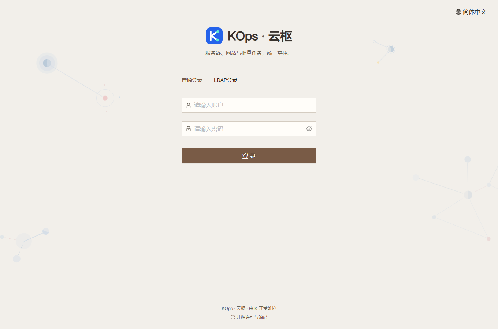
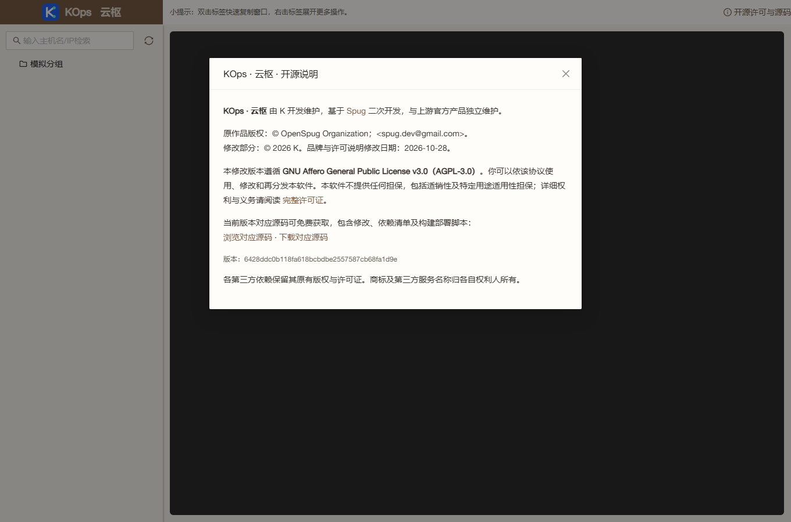

# KOps 日常界面品牌整理

应用提交 `6428ddc0b118fa618bcbdbe2557587cb68fa1d9e` 已发布，基准 `4564925c09969e0133b6250cd597bf3c80cd68c2`。沿用 `feature/operations-reliability` 与[草稿 PR #4](https://github.com/851855817/spug/pull/4)，不合并主分支。

## 可查看的变化

登录页、页脚和关于页面统一展示 KOps · 云枢及 K 维护。关于页面展示实际应用提交与中性内核版本，移除上游官网推广、更新日志和自动查询上游新版本。宝塔 API、主机导入、任务计划、发布流程、密钥和 LDAP 的普通提示改用“平台”，英文同步。

基本设置默认只显示外部服务用途；点击“服务商信息与凭据获取”才展开真实服务商和获取方法。已保存调用凭据、保存接口和第三方身份保持准确。

登录页、顶栏、页脚和独立终端继续提供显著的“开源许可与源码”入口，无须登录即可查看。原版权、基于 Spug 二次开发的来源、修改日期、AGPL、无担保、再分发权利、完整许可证和免费精确提交源码集中保留在该弹窗。未删除源码版权头或更名技术变量、服务路径。

## 实际验证

- 前端 39 套、397 项通过；生产构建成功，保留两条既有 Hook 依赖提示。
- 实际 Chrome 验证普通界面无旧品牌常驻文字、公共许可入口及完整声明、当前提交源码链接、服务商展开与收起、关于页面本地请求与实际版本、模拟凭据保存、LDAP/密钥提示和窄屏，无运行异常。[浏览器证据](2026-10-28-branding-cleanup-browser.json)。
- 独立审查的发布路径 tooltip 漏词已补齐，16 个 UI 运行文件与白名单完全一致。发布保护 149 项在 Linux 全部通过；Windows 跳过一项 Linux 锁测试。
- 服务器隔离后端 547 项（9 项既有环境条件跳过）、旧发布保护 10 项、镜像检查 6 项通过。无生产数据库挂载或客户接口调用。
- [PR CI](https://github.com/851855817/spug/actions/runs/40666902810) 与 [push CI](https://github.com/851855817/spug/actions/runs/40666892969) 全部通过，包含 MariaDB 并发检查。
- 匿名公开源码 1007 个文件与实际应用提交逐字节一致，原始 LICENSE 与产品完整许可文件一致。[源码证据](2026-10-28-branding-cleanup-source.json)。

## 发布与保全

独立 `branding-cleanup-ui` 配置只接受精确 16 个 UI 文件；拒绝所有 API 文件（包括测试），无模型或迁移改动。验证完整镜像 API 树和固定镜像身份，发布与回退只使用 UI 覆盖。

归档 SHA-256：`ae641d1692b00de6cd7252d4f7017339c2c002b58f87db64a2c4ead112132886`。

发布前重新核验真实线上版本、业务空闲和原进程。新配对备份 `/opt/spug/backups/20261028-175042-before-upgrade-6428ddc-1b837d9c` 校验有效。独立确认 63 个业务、模式、密钥保全对象不变；234/274 两份完整 API 树字节不变；原进程和 UI 收据有效，9 服务、15 健康项正常。[发布证据](2026-10-28-branding-cleanup-verification.json)。

服务器回环、公网 HTTPS 和本机 18080 隧道均为新版本。用户当前的暖瓷白 `porcelain` 与配置 revision 原样保留。未执行客户任务、宝塔登录、主动采集，未开启监控或提醒。

应用提交之后只补充验收记录和发布工具中 fifteen → sixteen 的错误提示文字；该提示不影响白名单或已发布应用。对应 8 项发布回归通过。

设计与实施：[规格](../superpowers/specs/2026-10-28-branding-cleanup-design.md)、[实施记录](../superpowers/plans/2026-10-28-branding-cleanup.md)、[许可与修改说明](../../MODIFICATIONS.md)。
