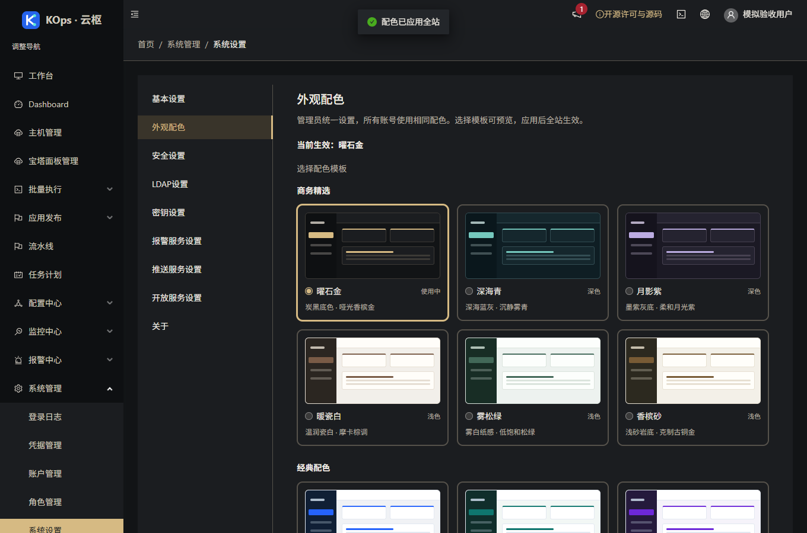

# 商务配色扩展：验收与发布记录

应用提交：`4564925c09969e0133b6250cd597bf3c80cd68c2`。分支 `feature/operations-reliability`，[草稿 PR #4](https://github.com/851855817/spug/pull/4)，不合并主分支。

## 可用功能

系统管理 → 系统设置 → 外观配色新增“商务精选”：曜石金、深海青、月影紫三套深色，暖瓷白、雾松绿、香槟砂三套浅色。原五套继续可选，共十一套。模板卡片展示微型后台轮廓；选择只改变预览，应用后所有账号统一使用。

弹窗、下拉、输入框和日期范围采用各模板的底色与强调色。正常、告警、异常保留语义颜色与文字。所有新增模板的正文、按钮以及选中背景的强调文字验证对比度；香槟砂选中背景为 4.83:1。

截图均为隔离模拟数据，未使用客户资产。

## 实际验证

- 前端 37 套、395 项通过；相关后端 51 项通过。
- 发布保护 141 项通过，Windows 上条件跳过一项 Linux 文件锁；服务器隔离准备在 Linux 运行实际锁回归。
- 真实 Chrome 验证十一套模板、六套新模板各七个主要页面（42 组），以及六套弹窗与下拉、窄屏和模拟跨账号同步。无运行异常。见 [浏览器证据](2026-10-28-refined-palettes-browser.json)。
- 新模板保存测试、派生颜色及日期范围真实 Less 编译测试、选中背景对比测试均经历失败再修复。规格审查与质量复核的实质问题全部关闭。
- 生产构建成功；保留两条原有 Hook 依赖提示，没有依赖升级。
- GitHub [PR CI](https://github.com/851855817/spug/actions/runs/40659188101) 与 [push CI](https://github.com/851855817/spug/actions/runs/40659181877) 成功，包含 MariaDB 并发检查。
- 995 个公开精确源码文件逐字节一致，原 LICENSE 与产品许可入口保留。见 [源码证据](2026-10-28-refined-palettes-source.json)。
- 服务器准备成功：547 项隔离后端测试（既有 9 项环境条件跳过），Linux 发布与回退、旧版发布和镜像内容验证通过。

## 发布状态

归档 SHA-256：`52ec824971dde9462df4e381255293379335053e3416101fcb5b35cd0ae73cfe`。

独立 `refined-palettes` 配置仅覆盖既有 `apps/setting/appearance.py` 和固定五个 UI 源文件；检查旧模块真实哈希、完整镜像 API 树、PHP/health 保全与不可变镜像身份。旧首次安装配置不放宽，回退恢复已有模块与 UI，不恢复数据库覆盖偏好。

首次上线预检发现 Web 终端 SSH 连接，修改服务前停止。使用者关闭终端并回复后，重新核验线上仍为 `df34e1a`、业务空闲、63 个保全对象及原进程身份，再执行受控发布。

已发布 `4564925`。成对备份 `/opt/spug/backups/20261028-165553-before-upgrade-4564925-dc0f6365` 校验有效；63 个业务、模式和密钥保全对象不变；两份 API 文件数仍为 234/274，仅既有 appearance 模块按清单替换。API/UI 原始收据、原进程、9 项服务与 15 项健康检查有效。服务器、公网与本地隧道均返回精确新版本。见 [独立发布核验](2026-10-28-refined-palettes-verification.json)。

发布辅助模块导入产生一个归档外 `.pyc` 缓存，独立检查严格拒绝；确认仅该已知派生缓存后精确删除，保留所有源码与应用数据，重新完整核验通过。后续调用辅助脚本宜带 `PYTHONDONTWRITEBYTECODE=1`，避免在已校验的归档目录产生缓存。

线上靛紫配置及原修订完整保留，发布未替使用者切换主题。测试、验收没有客户真实任务、主动采集或登录操作。

说明：[使用指南](../site-appearance-guide.md)、[规格](../superpowers/specs/2026-10-28-refined-palettes-design.md)、[实施记录](../superpowers/plans/2026-10-28-refined-palettes.md)。
