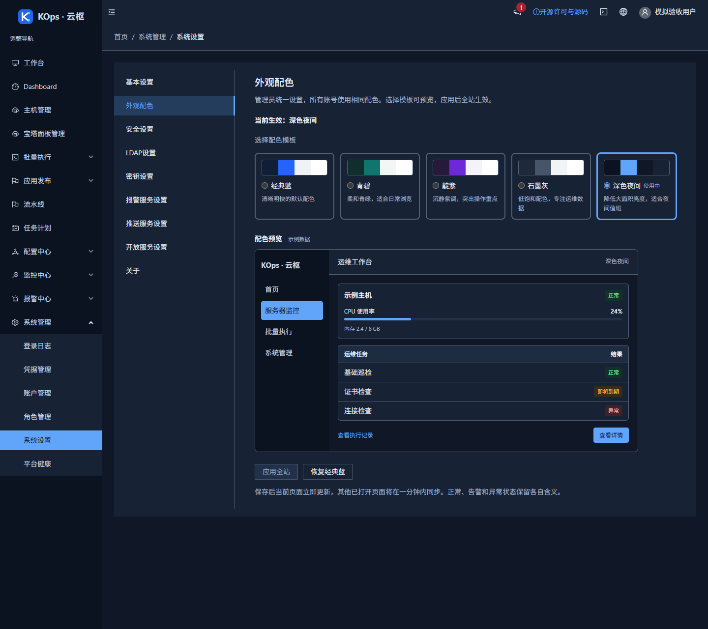
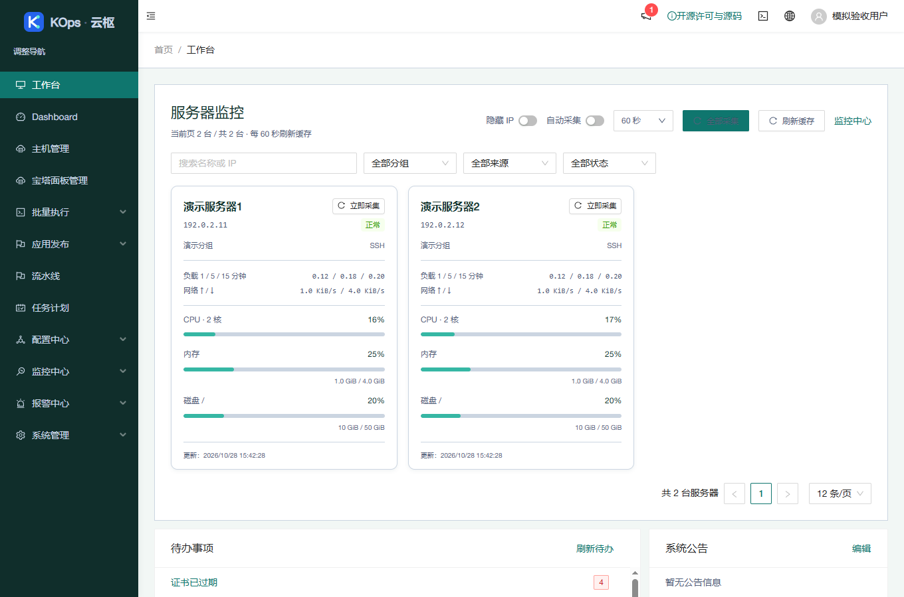
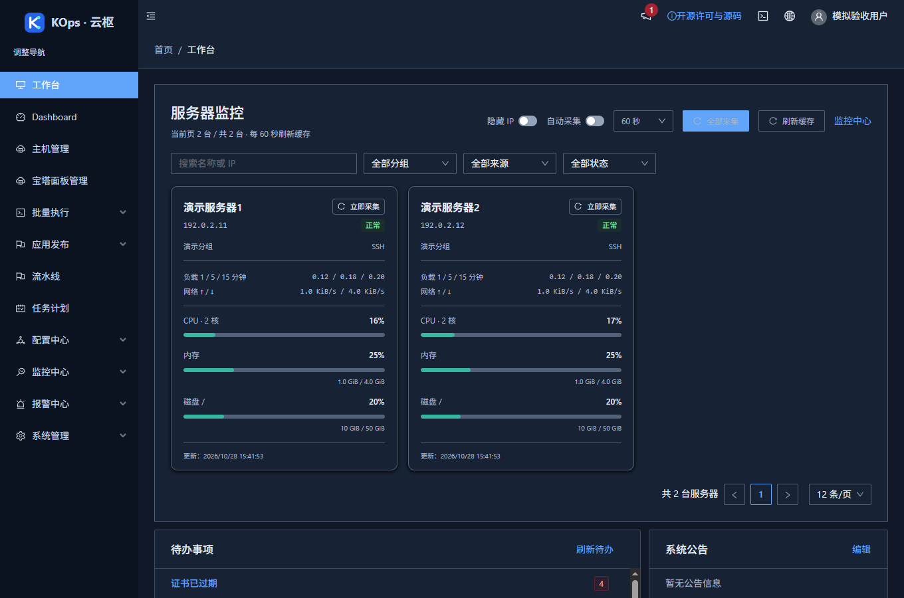

# 全站配色发布

2026-10-28 15:44（Asia/Shanghai）通过固定 `site-appearance` 配置发布应用 `df34e1a68535937f47ad7256f6914dd0897e1a54`，实际基准为 `9f749a877703aa593b9e95718f2520c775571057`。沿用 `feature/operations-reliability` 和草稿 [PR #4](https://github.com/851855817/spug/pull/4)，未合并主分支。

## 功能与入口

**系统管理 → 系统设置 → 外观配色**：活跃超级管理员可以预览经典蓝、青碧、靛紫、石墨灰、深色夜间，保存后所有账号统一使用；当前页面立即更新，其他可见页面约一分钟同步。预览只影响示例，取消选择不保存；恢复经典蓝需要确认。保存失败保留当前配色，其他管理员先保存时提示重新载入。

覆盖登录、导航、顶栏、首页监控、表格、弹窗和各业务页面；保留正常／告警／异常语义及终端、编辑器内容专用配色。上线保持默认经典蓝，由管理员选择。

使用说明：[全站配色](../site-appearance-guide.md)。下图均为最终构建的隔离模拟验收，不含客户数据。

## 验证

- 前端 37 套／393 项通过；相关后端设置及鉴权 51 项通过。SQLite 并发保存回归连续 20 轮通过，MariaDB CI 使用完整请求及中间件验证首次保存与更新竞争，均只有一个成功保存者。
- 正式生产构建通过，仅保留两处既有 Hook 依赖提示。AntD 4 暗色样式独立编译后用零特异性根选择器限制，修复 Less 重复导入和复合选择器失效；新增实际编译回归，检查布局、输入框、弹窗和关键帧。
- 独立审查核对 API 权限、最小公开字段、模板白名单、CAS、失败回退及同步状态。另核对 7,433 个受限选择器和 115 个保持不变的关键帧步骤。
- 实际 Chrome 检查五套模板及主要页面、宽窄屏、深色弹窗、终端外围与切回浅色；第二个独立窗口约 60.6 秒检测到同步。接口全部模拟，无运行异常。记录见 [浏览器摘要](2026-10-28-site-appearance-browser.json)。
- 服务器无网络隔离准备通过：547 后端（9 项条件跳过）、130 发布保护、10 旧发布保护、6 镜像检查；Linux 独占锁实际运行。
- 最终 [PR CI](https://github.com/851855817/spug/actions/runs/40651409609) 和 [push CI](https://github.com/851855817/spug/actions/runs/40651402358) 均通过，包含新增外观 MariaDB 回归、完整前端及构建。
- 匿名核对公开应用提交及 4,913,022 字节源码归档，985 个文件与 Git 内容逐字节一致，原 LICENSE 及界面许可副本一致。见 [源码摘要](2026-10-28-site-appearance-source.json)。

## 发布保全

精确范围为三个 API 模块和 91 个 UI／构建文件；API 仅新增外观视图并修改路由与精确匿名路径。没有模型或迁移。其余完整 API 树、PHP 更新和平台健康模块保留；专用配置不加入通用系统设置写入白名单。兼容回退只恢复运行文件和 Compose，新配置可由旧版本忽略，不恢复整个业务数据库。

归档 SHA-256：`8b02c6c18cb3db24400741a3840cb9767756c7b10ffda3437bc64a881a0bdfd5`。

本次配对备份：`/opt/spug/backups/20261028-154451-before-upgrade-df34e1a-1046a555`。

发布结果 `published=true`、`errors=[]`、HTTP 200。独立核对配对备份、63 项业务／模式／密钥对象及原保留进程身份一致；两份 API 树各 233／273 → 234／274，仅三个固定覆盖模块变化；两份 UI 各 115 → 120。API／UI 原始收据有效，九项服务和 15 项健康检查正常，健康 timer active。服务器、本机隧道及公网均返回新版本，匿名外观接口只返回经典蓝和版本字段，通用设置保持鉴权保护。详见 [发布核验摘要](2026-10-28-site-appearance-verification.json)。

测试未执行客户真实任务、远程命令、主动采集或宝塔登录，未开启监控和提醒。线上外观仅只读验证默认值，未代用户应用其他配色。
