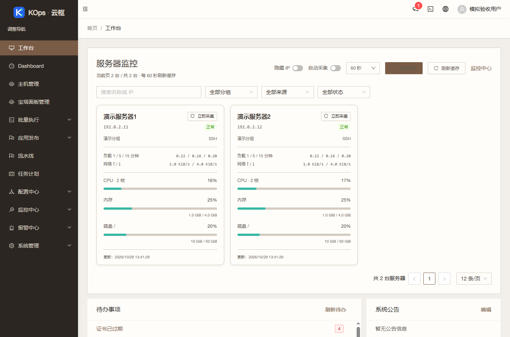
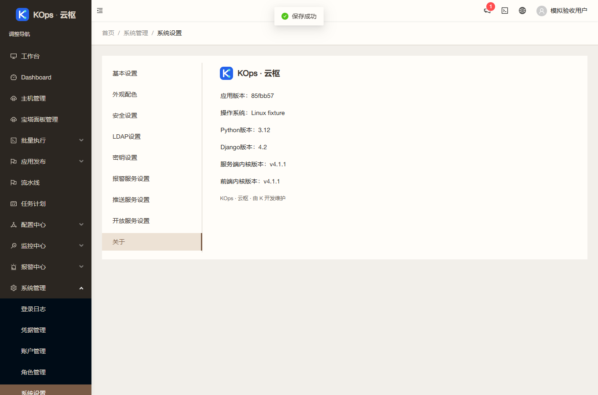

# 个人自用界面整理

应用提交 `85fbb57cb404b5d1e612a6ab4d6664d44cea8a92`，基准 `6428ddc0b118fa618bcbdbe2557587cb68fa1d9e`。沿用 `feature/operations-reliability` 与[草稿 PR #4](https://github.com/851855817/spug/pull/4)，不合并主分支。

## 可查看的变化

使用者进一步明确个人自用，并要求把截图中的说明全部去掉。登录、后台页脚、顶栏、关于和独立终端已移除“开源许可与源码”入口和整个弹窗，保留 KOps · 云枢品牌文字。基本设置移除上游介绍、获取凭据入口及二维码，已有调用凭据及保存接口不变。终端原文件管理、皮肤和操作提示保持。

项目 LICENSE、源文件原版权、修改记录、已存在的完整许可和对应源码文件保留。此变更针对用户声明的个人自用场景，不声明完全原创，也不把“不收费”作为所有使用方式的许可判断。

## 实际验证

- 前端 39 套、397 项通过；原行为对新期望的入口/推广移除测试先失败，修改后通过。生产构建成功，只有两条既有 Hook 依赖提示。
- 真实 Chrome 验证登录、顶栏、页脚、关于、独立终端无入口、弹窗与旧品牌；验证当前应用提交、模拟凭据原协议保存、LDAP/密钥中性提示和窄屏布局，无运行异常。[浏览器证据](2026-10-29-self-use-branding-browser.json)。
- 发布保护 157 项通过，Windows 条件跳过一项 Linux 锁，服务器隔离准备补验。新 profile 复用原 8 项完整契约，保持旧白名单及其测试。
- 独立规格与质量审查通过，并独立运行前端三组五项、新旧发布各八项回归。确认终端 handler、凭据协议、版权文件和所有发布保护不变。
- [PR CI](https://github.com/851855817/spug/actions/runs/40824724303) 与 [push CI](https://github.com/851855817/spug/actions/runs/40824718231) 全绿，包含 MariaDB 并发验证。
- 1015 个匿名公开对应源码文件与实际应用提交逐字节一致；原 LICENSE 与静态完整许可文件相同。[源码证据](2026-10-29-self-use-branding-source.json)。

## 发布范围

`self-use-branding-ui` 仅接受四个精确 UI 文件：LegalNotice、Header、独立终端 index、BasicSetting；拒绝任何 API 文件，包括测试。镜像只复制静态构建，完整 API 树按固定镜像身份验证。沿用新鲜空闲核验、配对备份、原始收据和仅 UI 的兼容回退。

归档 SHA-256：`2d2d231b2a8d13e22632a47ec15171dac5cc3e35a390a12220fb11642957b9d8`。

设计与进度：[实施记录](../superpowers/plans/2026-10-29-self-use-branding.md)、[修改说明](../../MODIFICATIONS.md)。

## 实际发布

已发布 `85fbb57`。服务器隔离准备实际运行 547 后端测试（9 项既有条件跳过）、157 Linux 发布保护、10 旧发布、6 镜像检查，全部通过。

新配对备份 `/opt/spug/backups/20261029-134424-before-upgrade-85fbb57-b365ca32` 有效。独立核验 63 个业务/模式/密钥保全对象、234/274 两份完整 API 树原样不变；原进程和 UI 原始收据有效，9 服务和 15 健康项正常。[独立发布证据](2026-10-29-self-use-branding-verification.json)。

公网、服务器回环、本机 18080 隧道版本一致；实际交付脚本已无入口和弹窗文案。暖瓷白 `porcelain` 及原配置 revision 保留。未执行客户真实任务、宝塔登录或主动采集，未开启监控/提醒。公共截图全部来自隔离模拟数据。
