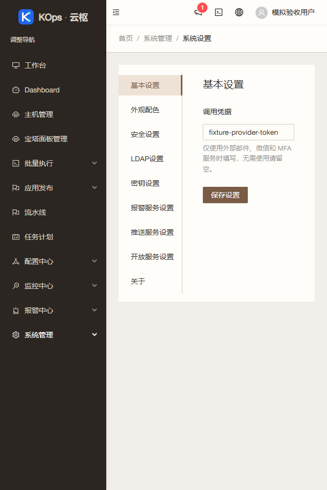

# 侧栏折叠修复

应用提交 `b1b674a9bff434cff7f024e0c79210fa5cc9aac6` 已上线，基准为 `85fbb57cb404b5d1e612a6ab4d6664d44cea8a92`。继续使用 `feature/operations-reliability` 和[草稿 PR #4](https://github.com/851855817/spug/pull/4)，不合并主分支。

## 可查看的变化

在“系统管理 → 系统设置”等页面，点击当前分组的折叠箭头或标题可正常收起、展开；收起后仍停留当前页面。切换页面或展开整个侧栏时，自动展开目标页面所属分组。权限过滤、同组导航排序和菜单结构保持。

根因是侧栏在每次渲染时强制展开当前分组，覆盖了手动收起操作。现在通过 Router 的路径变化和整体侧栏状态驱动展开，选中项保存在组件自己的状态中。

## 验证

- 旧版真实 Chrome 和三项新增回归测试均复现“点击后立即重开”；修复后前端 39 套、400 项通过。
- 真实 Chrome 验证箭头与标题点击、无关渲染、其他分组、页面切换与历史后退、整体侧栏恢复、原键盘排序和 640 窄屏通过。接口为模拟数据，零 API 写入、无运行异常。[浏览器证据](2026-10-30-sidebar-collapse-browser.json)。
- 独立规格及质量审查无阻塞；生产构建成功，只有两条既有 Hook 依赖提示。[PR CI](https://github.com/851855817/spug/actions/runs/41027997263) 和 [push CI](https://github.com/851855817/spug/actions/runs/41027988454) 全绿。
- 服务器隔离测试：547 后端测试（9 项既有条件跳过）、165 Linux 发布保护、10 旧发布保护和 6 镜像检查通过。
- 1024 个匿名公开对应源码文件与应用提交逐字节一致，原 LICENSE 保留。[源码证据](2026-10-30-sidebar-collapse-source.json)。

## 发布与保全

`sidebar-collapse-ui` 仅允许一个运行 UI 文件 `spug_web/src/layout/Sider.js`，拒绝所有 API 文件，包括测试。沿用完整 API 树保全、不可变镜像、新鲜空闲检查、配对备份和仅 UI 兼容回退。归档 SHA-256：`bca70e103028e25fb49ae4477111dc6cb7236c6a6f9565d046555ab799a0e9ab`。

发布前重新核实现网及业务空闲。新配对备份 `/opt/spug/backups/20261030-164439-before-upgrade-b1b674a-04adb972` 有效。独立确认 63 个业务、模式及密钥保全对象不变；234/274 两份完整 API 树不变，原进程和 UI 收据有效，9 服务及 15 健康项正常。暖瓷白配色及原 revision 保留。[独立发布证据](2026-10-30-sidebar-collapse-verification.json)。

公网、服务器回环与本机 18080 隧道均返回新版本；从本机读取公网及隧道实际主 JS/CSS，与本地生产构建逐字节一致。[入口证据](2026-10-30-sidebar-collapse-entries.json)。刷新后台后即可查看。

未执行客户真实任务、宝塔登录或主动采集，未开启客户监控和提醒。公共截图全部来自隔离模拟数据。[实施记录](../superpowers/plans/2026-10-30-sidebar-collapse.md)。
