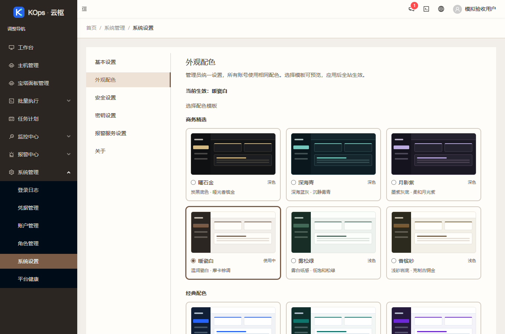
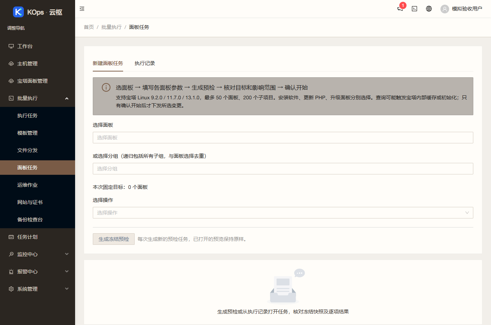

# 第一批低频功能入口隐藏

应用提交 `567eb5a5077f176bfffc9fc4e7c69b54b73a2fe9`，基准 `b1b674a9bff434cff7f024e0c79210fa5cc9aac6`。继续使用 `feature/operations-reliability` 及[草稿 PR #4](https://github.com/851855817/spug/pull/4)，不合并主分支。

## 已隐藏的入口

用户确认第一批清单后，侧栏隐藏 Dashboard、应用发布（发布配置、构建仓库、发布申请）、流水线、配置中心（环境、服务、应用配置）。系统设置隐藏 LDAP、推送服务、开放服务；面板任务隐藏官方接口目录标签。

四个主菜单使用 `hidden` 标志，侧栏过滤，路由注册及原权限检查保持。三个设置组件和接口目录不再挂载，其源码保留。原数据、凭据、权限和后台服务保持，既有任务不会因入口隐藏而停用。第二批所有入口保留；恢复第一批入口只需还原相应 UI 配置，无需恢复数据库。

## 实际验证

- 前端 39 套、401 项通过；新增菜单隐藏回归在旧代码上先失败，修复后通过。原折叠、拖拽和键盘排序测试保持。
- 真实 Chrome 确认四主菜单、三设置项及接口目录隐藏；主机、宝塔列表与核心入口正常，外观配色、折叠及原授权地址保持。零 API 写入、无运行异常。[浏览器证据](2026-11-03-hide-first-batch-browser.json)。
- 生产构建成功，仅两条既有 Hook 依赖提示。独立审查无阻塞，另运行新旧四个发布配置共 32 项测试通过。
- [push CI](https://github.com/851855817/spug/actions/runs/41598682439) 和 [PR CI](https://github.com/851855817/spug/actions/runs/41598689327) 全绿；1032 个公开对应源码文件与应用提交逐字节相同。[源码证据](2026-11-03-hide-first-batch-source.json)。
- 服务器隔离运行 547 后端测试（9 项既有条件跳过）、173 Linux 发布保护、10 旧发布保护、6 镜像检查，全部通过。

`hide-first-batch-ui` 只允许四个运行 UI 文件：`routes.js`、`layout/Sider.js`、`pages/system/setting/index.js`、`pages/exec/panel/index.js`（相对 `spug_web/src/`），拒绝全部 API 文件。保留完整 API 树验证、不可变镜像、配对备份、原进程及仅 UI 回退。共用保护测试动态选择范围外的额外文件，旧配置仍使用原越界路径，未放宽白名单。归档 SHA-256：`3b751a5b17d4262dbda9ed2780ca4cd7c43d681fdb949903c03e01ca6ff49050`。

## 发布

重新核实现网基准、业务空闲和原主题后受控发布。新配对备份 `/opt/spug/backups/20261103-155210-before-upgrade-567eb5a-7114cd9f`。独立验证及入口证据分别记录在[发布核验](2026-11-03-hide-first-batch-verification.json)和[公网与隧道核验](2026-11-03-hide-first-batch-entries.json)。

已上线 `567eb5a`。独立确认配对备份有效、63 个业务/模式/密钥对象、234/274 两份完整 API 树及原进程身份不变，UI 收据有效。9 服务及 15 健康项正常，健康定时器恢复；暖瓷白及原配置 revision 保留。公网、服务器回环、本机 18080 隧道版本一致，公网及隧道交付的主 JS/CSS 与本地生产构建逐字节相同。刷新后台即可查看。

未执行客户真实任务、宝塔登录或主动采集，未开启客户监控和提醒。公共截图只含模拟数据。[实施记录](../superpowers/plans/2026-11-03-hide-first-batch.md)、[使用手册](../spug-platform-user-manual.md)。
