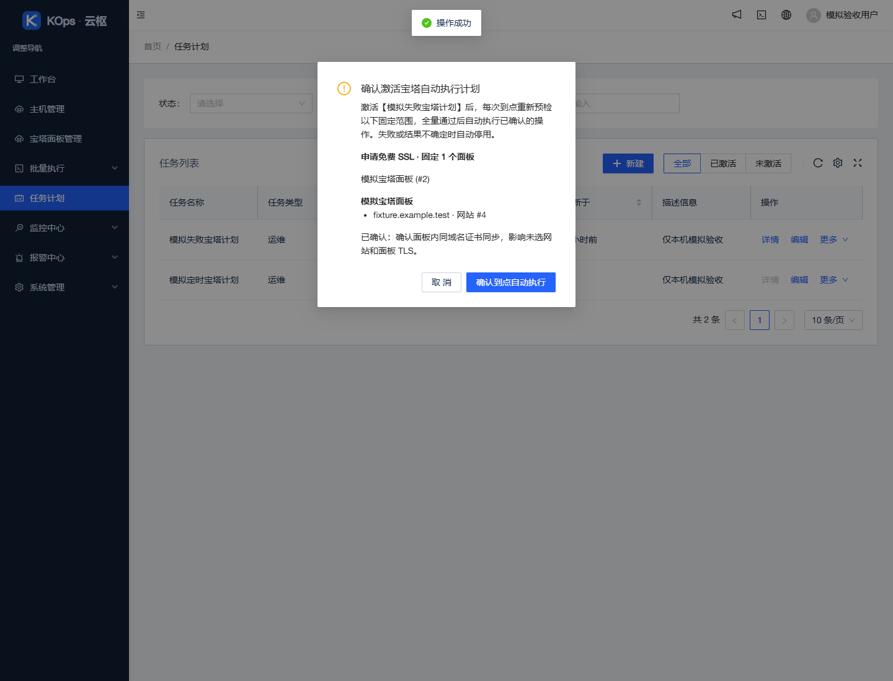
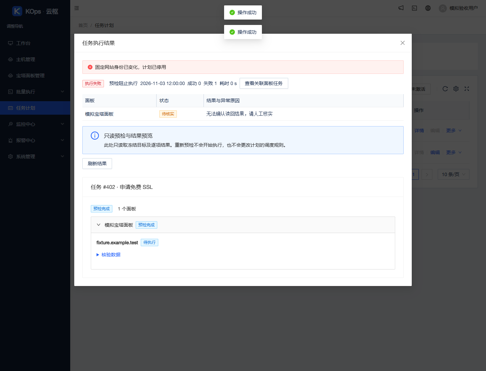

# 任务计划执行宝塔面板任务

应用 `48c305dbbd656fa9cc2ecbbf9be749fb390bf3fc` 已上线，基准 `567eb5a5077f176bfffc9fc4e7c69b54b73a2fe9`。沿用 `feature/operations-reliability` 与[草稿 PR #4](https://github.com/851855817/spug/pull/4)，不合并主分支。

## 使用入口

**任务计划 → 新建 → 任务内容 → 宝塔面板任务**。选择或新建预检，确认固定面板、网站、操作参数及影响项，配置一次性、间隔或 Cron 时间。保存后默认未激活；在「更多 → 激活任务」确认到点自动执行。

每次到点重新检查账号、权限、API 配置、固定对象与操作条件，全部目标预检通过才执行。失败或结果待核实时自动停用，保留逐台原因与已有结果。运行中再次触发记为跳过；触发及上次完成后的间隔至少 300 秒，不补跑错过的时点、不自动重发不确定操作。范围及期望软件版本固定，不自动加入新增客户、网站或追踪新版本。

**详情／历史记录**查看阶段、成功／失败／跳过、异常原因、逐台输出与关联面板任务只读详情。「重新预检」只生成预览。上传计划保留所引用源文件并占用配额；禁用会阻止后续发送，但不能撤销已接受或已发出的请求。支持操作、权限与示例见[使用指南](../scheduled-panel-tasks-guide.md)。

## 实际验证

- 前端 44 套／434 项通过，任务计划目录 ESLint 无警告或错误；生产构建成功，仅两处既有 Hook 提示。
- 真实隔离 Chrome 对最终发布构建完成 17 项断言、18 个模拟 API 请求、3 个模拟写入；无客户请求、开始执行调用、运行异常或控制台错误。[浏览器记录](2026-11-03-scheduled-panel-tasks-browser.json)。
- 独立后端与前端审查覆盖手工开始旁路、权限撤销、锁顺序、调度重启、发送意图、范围身份、上传保留和归属、冷却、通知及历史清理。发现的问题已修复并补充回归；独立追加 6 个 SQLite 重启与授权探针通过。
- 最终应用 [push CI](https://github.com/851855817/spug/actions/runs/41607338822) 与 [PR CI](https://github.com/851855817/spug/actions/runs/41607347759) 的前端、后端、MariaDB 全绿，含真实数据库并发认领测试。
- 服务器受限、无网络、不挂生产数据的隔离环境运行 581 项后端测试（10 项条件跳过）、185 项 Linux 发布保护、10 项旧发布保护、6 项镜像检查，全部通过。首次准备发现 CI 配置缺少于归档，修正打包清单并增加先失败后通过的归档字节回归，重新提交和完整准备，未改动已校验暂存产物或绕过门。
- 1062 个匿名可下载的对应源码文件与精确应用提交逐字节一致，原许可文件保留。[源码记录](2026-11-03-scheduled-panel-tasks-source.json)。

本地完整后端曾运行 578 项（11 项跳过），后来补充 3 项专项；最终服务器完整 581 项及 MariaDB CI 为交付依据。既有极短 transport deadline 用例在 Windows 曾出现一次时序失败，隔离复跑及后续完整回归通过，没有修改生产 transport 或放宽断言。

## 发布与保全

`scheduled-panel-tasks` 精确允许 11 个运行 API 模块与 13 个任务计划 UI 文件；仅新 `apps/schedule/panel_tasks.py` 的原摘要为空。模型未新增字段或迁移，沿用原 Task/History 表。面板 ID 保存在类型化计划内，不进入 Host targets。原解释器、动态监控目标与手工任务保留；定时执行复用既有面板适配器、持久执行意图和面板锁。

发布前重新核实现网、业务空闲、主题与保全摘要，完成新数据库／数据卷配对备份：`/opt/spug/backups/20261103-170655-before-upgrade-48c305d-be3cb5c9`。归档 SHA-256 为 `77bc765a53abd07741f07aef561f1f084bf151e4e0870dc5fe6a33d01c459a47`。

独立验证 63 个业务／模式／密钥保全对象及原进程身份一致；两份完整 API 树仅精确覆盖 11 个模块、各增加一个新文件（234→235、274→275），其他文件保留。API/UI 原始收据及配对备份有效，9 服务、15 健康项正常，健康 timer 恢复。暖瓷白及原配置 revision 保留。[发布核验](2026-11-03-scheduled-panel-tasks-verification.json)。

公网 `https://47.104.88.147`、服务器回环和本机 `http://127.0.0.1:18080` 版本一致；公网与本机交付的主 JS/CSS 与本地发布构建逐字节相同，任务计划地址可加载，未登录 API 继续受保护。[入口核验](2026-11-03-scheduled-panel-tasks-entries.json)。

未创建或激活客户真实计划，未执行客户升级、安装、卸载、证书、上传、远程命令、宝塔登录或主动采集，未开启客户监控或提醒。公共截图仅为模拟数据。文档提交可晚于应用提交。[实施记录](../superpowers/plans/2026-11-03-scheduled-panel-tasks.md)。
